<div align="center">

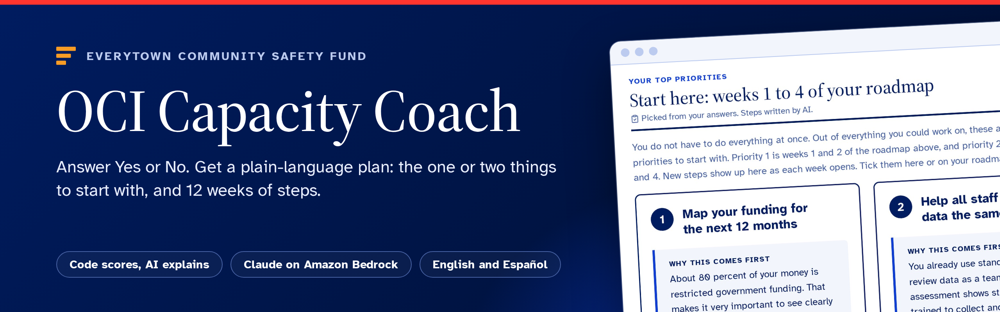

[Live app](https://d2mi2h3eu8y69s.cloudfront.net) • [Demo video](docs/demo/oci-capacity-coach-demo.mp4) • [Technical guide](docs/technical-guide.md) • [Pitch deck](docs/pitch/OCI-Capacity-Coach-pitch.pdf) • [Changelog](CHANGELOG.md) • [Releases](https://github.com/ArielleTolome/everytown-oci/releases)

[](https://github.com/ArielleTolome/everytown-oci/releases)
[](https://github.com/ArielleTolome/everytown-oci/actions/workflows/package.yml)
[](requirements.txt)
[](frontend/)
[](#architecture)
[](#accessibility)
[](LICENSE)

</div>

---

## What is OCI Capacity Coach?

The Organizational Capacity Index (OCI) for community violence intervention (CVI) nonprofits in Everytown's Community Safety Fund network. An organization's leader signs in, answers a Yes/No self-assessment, and gets a plain-language report: what is true about the organization today, the one or two priorities to start with, and a 30 / 60 / 90 day plan, on screen and as a PDF. Everytown staff get a network dashboard that shows which training and services grantees need and which grantees share the same problems, so they can be connected.

[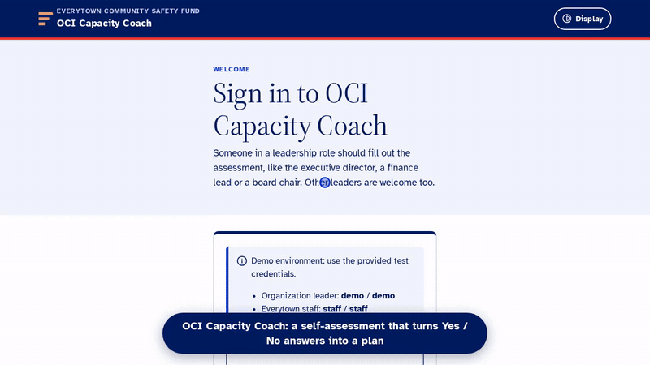](docs/demo/oci-capacity-coach-demo.mp4)

<sub>Demo recorded on the live site with synthetic data; the AI waits are sped up. Click it for the full video (MP4, 1280 x 720). Rebuild it with <code>python3 scripts/build_readme_media.py demo</code>.</sub>

- Deterministic Python code computes every score. The engine is the reference implementation, unchanged, and `verify_benchmark.py` proves it against the answer key.
- Claude on Amazon Bedrock writes the coaching narrative around those fixed scores. The server then validates the output: every action must cite real growth priorities from this submission, and every link must come from the curated resource catalog.

AWS Breaking Barriers 2026 hackathon build. Full brief: [`docs/vision.md`](docs/vision.md), [`docs/tech.md`](docs/tech.md).

The tool is designed to sit inside the [Everytown Community Safety Fund](https://everytownsupportfund.org/everytown-community-safety-fund/) Grantee Portal: CSF says new grantees "complete a self-assessment that shapes their participation in cohort-based and customized training through our Community Training Institute", and the portal is where grantees "sign up for future training opportunities and complete surveys". The look follows that site (navy and royal blue, serif headlines, pill buttons, pale-blue title bands).

> **Current release:** v1.10.8 (the answer-style choice shows each style's estimated time and the time it saves; v1.10.7: this README in a new layout with a banner and a demo video; before that, fixes from the Nov 4 user test; a 6-slide presentation in plain English with a before-and-now slide; the script also as a Word document; deploys recorded as GitHub Deployments; every feature and its benefit in [`docs/features-and-benefits.md`](docs/features-and-benefits.md)). The full technical guide to the whole system is [`docs/technical-guide.md`](docs/technical-guide.md) (also attached to the release as a PDF). See [CHANGELOG.md](CHANGELOG.md) and the GitHub Releases page. The container image is on [GitHub Packages](https://github.com/ArielleTolome/everytown-oci/pkgs/container/everytown-oci) (see [Container](#container-github-packages)); what is live and from which commit is on [GitHub Deployments](https://github.com/ArielleTolome/everytown-oci/deployments) (see [Deploying to AWS](#deploying-to-aws)). AI observability runs on Amazon CloudWatch and Arize Phoenix (see [Observability and evals](#observability-and-evals-amazon-cloudwatch-and-arize-phoenix)). The pitch deck PDF is built from [`docs/pitch/index.html`](docs/pitch/index.html) with `python3 scripts/build_pitch_pdf.py`; 10-minute presentation script (7 minutes plus judges' questions): [`docs/pitch/demo-script.md`](docs/pitch/demo-script.md). Next steps from the CSF director walkthrough: [`docs/next-steps.md`](docs/next-steps.md).

**Contents**

- [Try it live (for judges)](#try-it-live-for-judges)
- [Quick Start](#quick-start): [run it locally](#run-it-locally) · [container](#container-github-packages) · [checks](#checks)
- [Core Concepts](#core-concepts): [vision](#vision) · [scoring](#scoring) · [architecture](#architecture) · [data model](#data-model-schemasql)
- [Product Tour](#product-tour): [screenshots](#what-it-looks-like-live-v10) · [user journey](#user-journey) · [accessibility](#accessibility) · [design process](#design-process)
- [Running in Production](#running-in-production): [deploying to AWS](#deploying-to-aws) · [configuration](#configuration) · [observability and evals](#observability-and-evals-amazon-cloudwatch-and-arize-phoenix) · [end-to-end tests](#end-to-end-tests-and-bug-bash-e2e) · [security](#security-notes)
- [Resources](#resources): [documentation](#documentation) · [layout](#layout) · [release process](#release-process) · [license](#license)

---

## Try it live (for judges)

| | |
|---|---|
| **Web app** | **https://d2mi2h3eu8y69s.cloudfront.net** |
| Sign in as an organization leader | `demo` / `demo` |
| Sign in as Everytown staff | `staff` / `staff` |

1. Sign in as `demo`, open **Try a made-up sample organization** and pick one: the answers are filled in, the stages appear at once and the AI report is ready in about 40 seconds. Or answer the questionnaire yourself (choose fewer areas to go faster).
2. On the report: **Your 12-week roadmap**, **Start here**, **Chat about your report** (bottom right), **Listen**, **Download PDF report**, then **Stay connected with the Community Safety Fund** and **Does this feel right?** near the end.
3. Sign out, sign in as `staff`: **Training needs**, **Ask the data**, **Peers**, **Quality and follow-through** (organization feedback and a review queue, roadmap follow-through, opt-ins, where people stop); click an organization for its drawer and its **View AI trace in Phoenix (staff)** and **View AI trace in CloudWatch (staff)** links (they open Arize Phoenix and the AWS console, which need their own sign-ins; we can show them on request).

Everything in the app is synthetic, the login is mocked, and the URL is temporary: it is torn down after judging. New reports are capped per hour across all visitors, so if one is refused, try again later or open an existing report. Pitch deck: [`docs/pitch/OCI-Capacity-Coach-pitch.pdf`](docs/pitch/OCI-Capacity-Coach-pitch.pdf).

---

## Quick Start

### Run it locally

Requires Python 3.9+, Node 20+, AWS credentials with Bedrock access to Anthropic Claude, and the database stack (`everytown-oci-db`, created by `scripts/deploy.sh`). Local and cloud share the same Aurora database through the RDS Data API, so there is no local database to install.

```
pip install -r requirements.txt
export AWS_DEFAULT_REGION=us-west-2 AWS_ACCESS_KEY_ID=... AWS_SECRET_ACCESS_KEY=... AWS_SESSION_TOKEN=...
export OCI_DB_CLUSTER_ARN=... OCI_DB_SECRET_ARN=...     # outputs of the everytown-oci-db stack
python3 -m db migrate && python3 -m db seed              # schema + 20 synthetic organizations
python3 app.py                                            # JSON API on :8000
cd frontend && npm ci && npm run dev                      # Astro on :4321, proxies /api to :8000
```

Open http://127.0.0.1:4321 and sign in with `demo` / `demo` (organization leader) or `staff` / `staff` (Everytown staff dashboard). Locally the AI steps run in a background thread. Without `OCI_KB_ID`, the whole field-guide library is injected into the prompt.

### Container (GitHub Packages)

Every release tag publishes `ghcr.io/arielletolome/everytown-oci` (`latest`, the version, and the commit) through `.github/workflows/package.yml`. The image runs the Flask API and the built Astro site on one port (`serve.py` under gunicorn), as CloudFront and S3 do on AWS. It is not standalone: it needs AWS credentials with Bedrock access to Claude and the `everytown-oci-db` stack (Aurora through the RDS Data API), because there is no local database.

```
docker pull ghcr.io/arielletolome/everytown-oci:latest
# oci.env: AWS_DEFAULT_REGION, AWS_ACCESS_KEY_ID, AWS_SECRET_ACCESS_KEY (and AWS_SESSION_TOKEN),
#          OCI_DB_CLUSTER_ARN, OCI_DB_SECRET_ARN, optional OCI_KB_ID and OCI_SECRET_KEY (see Configuration)
docker run --rm --env-file oci.env ghcr.io/arielletolome/everytown-oci:latest python -m db migrate   # once
docker run --rm --env-file oci.env ghcr.io/arielletolome/everytown-oci:latest python -m db seed      # optional: 20 synthetic organizations
docker run --rm -p 8000:8000 --env-file oci.env ghcr.io/arielletolome/everytown-oci:latest
```

Open http://127.0.0.1:8000 and sign in with `demo` / `demo` or `staff` / `staff`. The AI steps run in a background thread of the one gunicorn worker. Build it yourself with `docker build -t oci-coach .`; secrets, `infra/` and `instance/` are excluded by `.dockerignore`.

### Checks

```
python3 verify_benchmark.py                 # expect three PASS lines
python3 -m unittest discover -s tests       # grounding validation and re-assessment comparison
cd frontend && npx astro check && npm run build
```

---

## Core Concepts

### Vision

The manual 2025 pilot helped 45 organizations, but two CSF staff wrote every report by hand, so it could not reach the 140+ organization network. The Capacity Coach turns that into a five-minute-per-domain self-service flow, so CSF staff can spend their time on coaching instead of report writing.

Design principles, taken from the builder package:

| Principle | Source | How the product applies it |
|---|---|---|
| A learning tool, not an evaluation | OCI handoff deck: "a learning experience, not an evaluative one" | Results lead with the stage ladder (Seeding to Transformational); percentages come second. Gaps are called "growth priorities". |
| Reduce burden | Handoff deck design specifications | You choose which areas to assess today. Answers are kept per area. The website is optional. |
| Actionable within weeks | Vision doc success metric | A 30 / 60 / 90 day plan with a role owner for each action (BJA checklist 3.2: tasks, deadlines, people responsible). |
| Team reflection | Handoff deck speaker notes | A "Team conversation guide" for the next leadership meeting. |
| Grounded, never invented | Tech doc: the LLM never scores | Server-side grounding validation; resource links only from `resources/catalog.json`. |
| Accessible to everyone | Community Empowerment track | WCAG 2.2 AA, Atkinson Hyperlegible font, larger-text and high-contrast modes, read-aloud, Spanish reports. |
| Readable at an 8th grade level | Everytown interview: "I can read this even though I'm at an 8th grade reading level and I've been to prison" | The prompt writes for leaders of 5 to 20 person groups with lived experience: short sentences, everyday words. |
| One or two things first | Everytown interview: "out of the 10 things you could fix, here's one or two priorities that you should do first" | A validated "Start here" section with at most two grounded priorities, before the full plan. |
| Learn across the network | Everytown interview: "if 50 or 75 or 100 of them take this assessment... I know what training they need"; "identify groups of grantees with similar problems that we could connect" | Aurora PostgreSQL stores every assessment; the staff dashboard shows stage distributions, the most common growth priorities, and "Grantees to connect" cohorts. |
| Benchmarking later, never for grantees | Everytown interview (future capability) and handoff deck ("no external benchmarking") | A `domain_benchmarks` SQL view ranks organizations per domain; only the staff dashboard shows it, labelled as a preview. |

### Scoring

A statement is a gap when `answer == trigger_on`.

```
gap_density_bonus = 1 + gaps_in_domain / statements_in_domain     # 1.0 .. 2.0
priority_score    = stage_weight * domain_weight * gap_density_bonus
```

- Stage weight runs from 5 (Seeding) down to 1 (Transformational). Domain weight runs from 0.7 to 1.0.
- Priority bands (High, Medium, Low) are percentile thirds of all gaps in *this* submission. They are relative, so assessing 4 areas instead of 8 can move a gap into a different band. Capacity percentages and stages are per domain and do not change.
- An unanswered statement would count as favorable, so the app requires every statement to be answered.
- `PL1` is reverse-coded (`trigger_on: "yes"`).

### Architecture

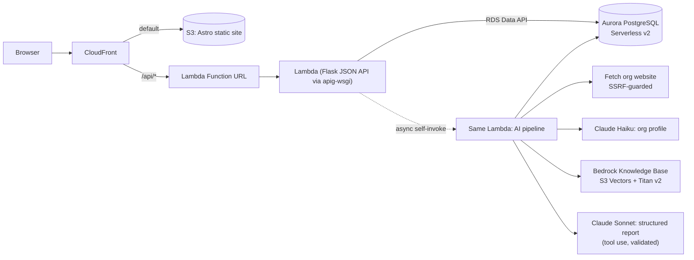

The pipeline is hardcoded, not agentic, as the tech doc prefers:

| Step | Code | Model |
|---|---|---|
| Score | `engine/scoring.py` (unchanged reference implementation) | none |
| Research the website, social links and news | `pipeline.research` | `OCI_FAST_MODEL_ID` (Claude Haiku) |
| Consult the CVI library | `pipeline.gather_library`: one Knowledge Base retrieval per assessed area, queried with its top growth priorities | Titan Text Embeddings v2 |
| Write the report | `pipeline.write_report`: Converse tool use with a JSON schema, then `validate_report` drops ungrounded actions and unknown links | `OCI_MODEL_ID` (Claude Sonnet) |
| Check reading level | `pipeline.plain_language`: fixed Flesch-Kincaid grade; above 8.5, one rewrite step, rejected if any id or link changes | `OCI_FAST_MODEL_ID` (Claude Haiku) |
| On demand: ask, listen, brief | `features/coach.py` (one validated call per question), `features/tts.py` (Amazon Polly generative voices), `features/staff_ai.py` (aggregated counts only) | Claude Haiku / Sonnet, Amazon Polly |
| Render | `frontend/src/pages/results.astro` + `frontend/src/lib/results.ts`, `report.py` (fpdf2, Unicode TTF, bookmarks, PDF language tag) | none |

Why Lambda instead of the Fargate stretch goal: CloudFront cannot reach a Fargate task without a load balancer, and App Runner is closed to new customers. One Lambda behind CloudFront scales to zero and needs no VPC or NAT, because it reaches Aurora through the HTTPS Data API.

Why Aurora PostgreSQL Serverless v2: the Everytown interview asked for network analytics over time, which is relational work (joins across organizations, assessments, growth priorities). Managed RDS gives backups, patching and encryption that a self-hosted database on EC2 would need by hand, and Oracle would add licensing cost for no benefit. The vision doc originally listed a relational database as out of scope; the interview changed that.

#### Data model (`schema.sql`)

| Table / view | Purpose |
|---|---|
| `organizations` | One row per organization, matched by normalized name (login is mocked). |
| `assessments` | One row per submission: `source` (web, demo, seed), status, and the full rendered document as `jsonb`. |
| `answers`, `domain_results`, `gaps` | Normalized deterministic results for analytics. Written once at submit, never by the model. |
| `latest_assessments` (view) | Each organization's most recent assessment: the unit for network analytics. |
| `domain_benchmarks` (view) | Peer percentile per organization and domain. Staff only; future benchmarking. |
| `support_requests` | Areas an organization asked CSF for training or coaching in, per assessment. The staff dashboard counts each organization's latest request. |
| `coach_messages` (`features/coach.sql`) | "Chat about your report" questions and validated answers, per assessment. |
| `roadmap_tasks` (`features/milestones.sql`) | Ticked roadmap steps per assessment, with time; points, streaks and badges are computed in code from it. |
| `peer_requests` (`features/peers_request.sql`) | Organizations that asked CSF to connect them with similar groups. |
| `assessments.respondent_role`, `organizations.budget`, `draft_shares.role` (`features/respondent.sql`) | Who filled it out, yearly budget band, and the role of each teammate who answered a shared area. |
| `drafts`, `draft_shares` (`features/drafts.sql`) | Server-side questionnaire drafts and per-area teammate share links. |
| `organizations.program_models`, `staff_size`, `states` (`features/orgmeta.sql`) | Optional organization details for grouping (up to 10 states or territories since v1.9; the old `state` column is unused); never scored. |

---

## Product Tour

### What it looks like (live, v1.0)

| | |
|---|---|
| 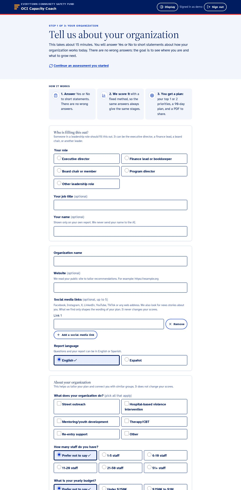 | 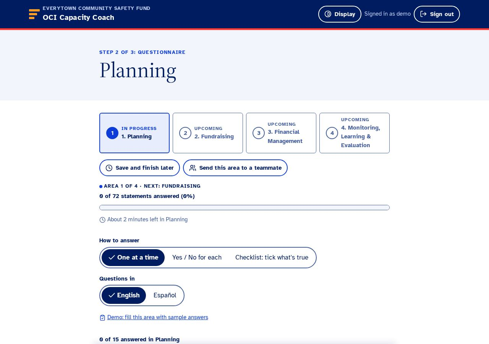 |
| 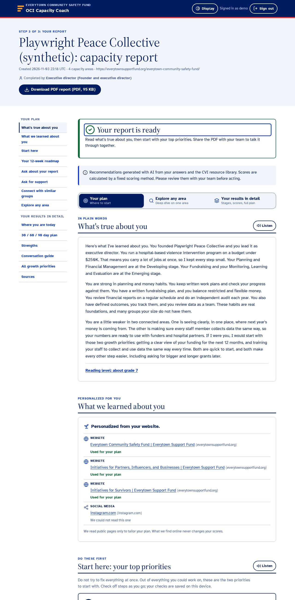 | 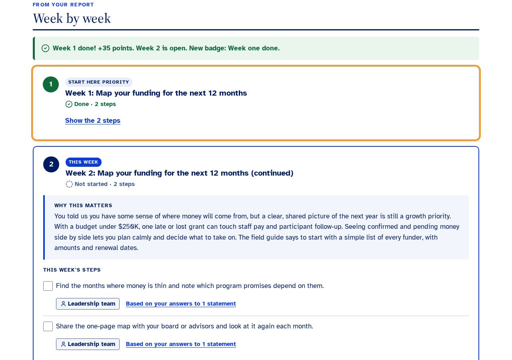 |
| 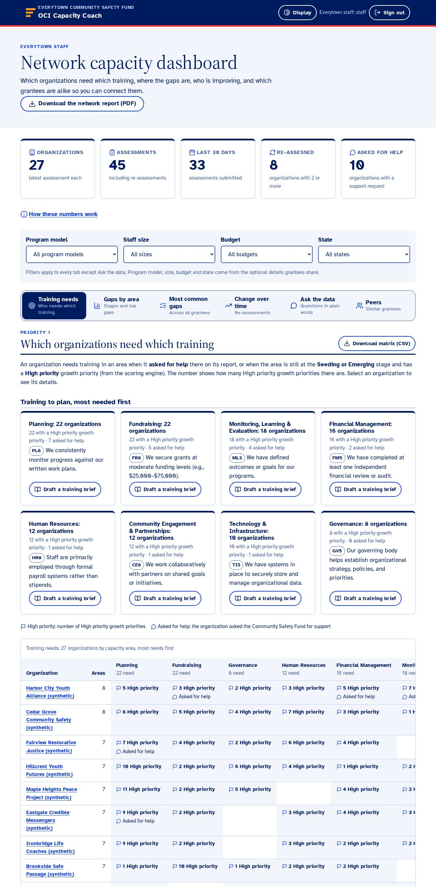 | 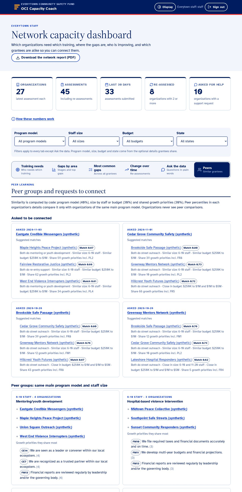 |

### User journey

1. Sign in with the mocked credentials.
2. Say who is filling it out (role, job title and name required: roles are Executive director, Finance lead or bookkeeper, Board chair or member, Program director, Other leadership role; the name is shown only on the organization's own report and never sent to the AI). Enter the organization name, what it does (program model), its size (staff and yearly budget), its website and up to 5 social media links. Pick English or Español in the language switch at the top right (it sets both the questions and the report, so also the read-aloud voice), list the states or territories the organization works in (up to 10), and choose the areas to assess; the four priority areas are pre-selected. Or open "Try a made-up sample organization" for a one-click demo.
3. Before the first question, pick how to answer from one sample statement shown three ways (One at a time, Yes / No for each, Checklist), each with its estimated time and the time it saves against Yes / No for each; the choice sticks, and "Change how I answer" under the questions switches later. Answer one area at a time. "One at a time" shows one statement per card with big Yes / No buttons (Y and N keys work), and asks the 5 laddered topics (funding horizon, largest grant, planning, audits, fundraising staff) as one multiple-choice question; the next step, "Your choice filled in these answers", shows the Yes / No it picked for each statement as selected answers you can flip. Every card has Previous and Next in the same place (a button that cannot be used yet says why); Previous goes back through the cards in the order you saw them, and the progress line shows which card you are on (Question N of M). Jargon help, the English / Español switch, save and resume, and "Send this area to a teammate" (who is asked their role and picks their own answer style) work as before. Every statement must end up with an explicit yes or no.
4. The results page opens on **Explore any area** with each area's stage right away, then live progress through: reading answers, scoring, researching the website, social media and news, consulting the CVI resource library, writing recommendations and checking the reading level. If a step fails, "Try again" reruns only the AI steps.
5. **Your plan** (the default layer once the report is ready): Summary about your organization, in a coach's voice; your 12-week roadmap; Start here (one or two priorities chosen by code, side by side, showing only the steps of weeks that are open: they are weeks 1 to 4 of the roadmap); ask CSF for support; "Connect me with similar groups"; and, last, what we learned about you online, with sources. A small label under each heading says what came from your answers and what AI wrote. **Chat about your report** (a button at the bottom right) opens a chat that knows the whole report and roadmap and keeps the conversation. **Explore any area** deep-dives into any assessed area. The PDF opens with a two-to-three page letter, then "Behind the plan: your detailed results" (scores by area, strengths, the full 30 / 60 / 90 day plan); every PDF has a light Everytown watermark and a confidentiality clause.
6. **12-week roadmap** (`/plan/?id=`): points, level and badges at the top (with the next badge and what earns it), then a timeline of all 12 weeks (done, this week, or when it opens); pick a week to see its steps. One week at a time opens (the next when this one is done, or after 7 days). Tick steps, download each week as a one-page PDF; finishing a week pops up a badge. Week 12 is "Retake the OCI", and re-assessment progress then shows what changed.
7. **Everytown staff** sign in as `staff`: tabs in the CSF director's priority order. Training needs (which organizations need which training), Gaps by area (group by program model, size, budget or who answered), Most common gaps, Change over time (including "Did support help?"), Ask the data (plain-language questions answered from pre-built analyses), and Peers (similar grantees by program model, size and shared gaps; peer requests). Each organization opens a drawer with its roadmap progress. Download the network report PDF or any table as CSV.

### Accessibility

- Semantic HTML: landmarks, skip link, one `<fieldset>`/`<legend>` per statement, native radios and checkboxes, real `<table>` with caption.
- Error summaries that take focus and link to each field; per-field errors tied with `aria-describedby`.
- Live processing status in a polite live region that announces only step changes; focus moves to "Your report is ready".
- Atkinson Hyperlegible (designed for low-vision readers), Display menu for larger text and high contrast, `prefers-reduced-motion` respected, 44px targets.
- AI-written text is marked with its language (`lang="es"`), so screen readers switch voice. Listen buttons play Amazon Polly generative voices (Ruth, Lupe) with speed control.
- The questionnaire offers a checklist view, Y/N keyboard shortcuts (only when focus is in a statement), plain-language jargon help and a Spanish translation.
- The PDF uses real text, bookmarks per section, a document language and title. Every PDF (report, weekly page, staff network report) carries a light Everytown watermark, a confidentiality footer and a closing confidentiality clause.
- The sticky questionnaire action bar reserves its height with `scroll-padding-bottom`, so it never hides the focused control (WCAG 2.4.11).
- Checked with axe-core (WCAG 2.0/2.1/2.2 A and AA rules) at 1280 and 375 px: no violations on login, organization, questionnaire, processing, report and staff pages.

### Design process

- Tokens and rules: `design-system/everytown-oci/MASTER.md` plus per-page overrides (kept outside this repo in the workshop folder), built with the `ui-ux-pro-max` skill.
- Reference research: Mobbin MCP searches for assessment results, multi-step questionnaires, onboarding pickers and admin analytics; the screens we adapted are linked in the v0.6.0 changelog.
- Visual exploration: Google Stitch project "Everytown OCI Capacity Coach" with an Everytown design system (navy, royal blue, red, Atkinson Hyperlegible). Stitch's layouts were re-implemented in Astro; its placeholder copy was discarded.
- v1.5 UI/UX pass: `PRODUCT.md` written with the impeccable skill (`/impeccable init`); a Hallmark audit (audit mode only, findings applied within the Everytown look) of the start page and questionnaire; then `/impeccable clarify` (questionnaire and results wording), `adapt` (phones), `harden` (empty, error and half-finished states) and `quieter` (results page and staff dashboard). Design deviations are recorded in the design-system `pages/*.md`.

---

## Running in Production

### Deploying to AWS

Two CloudFormation stacks:
- `everytown-oci-db` (`infra/database.yaml`): Aurora PostgreSQL Serverless v2 with the RDS Data API and an RDS-managed secret. Data lifecycle is independent of the app.
- `everytown-oci` (`infra/template.yaml`): CloudFront serving the Astro static site from a private S3 bucket (origin access control) and routing `/api/*` to one Python 3.12 Lambda (Flask JSON API via apig-wsgi, plus an async self-invoke for the AI pipeline) whose Function URL accepts only IAM-signed requests from this distribution (Lambda origin access control), Bedrock Knowledge Base on S3 Vectors over `resources/library/*.md`, IAM roles. No Cognito, load balancer, WAF, custom KMS keys or NAT.

Requirements: AWS CLI v2, Python 3 with pip and boto3, Node 20+, `zip`, credentials in the environment, Bedrock model access for Anthropic Claude and Titan Text Embeddings v2.

```
scripts/deploy.sh                      # db stack, site build, Lambda zip, app stack, site sync + invalidation, db migrate/seed, KB ingest
MONTHLY_BUDGET_USD=0 scripts/deploy.sh # this hackathon sandbox denies budget creation; elsewhere leave the default ($100 budget)
DB_MIN_CAPACITY=0 scripts/deploy.sh    # Aurora auto-pause after 1 idle hour (about 15 s resume on the next request)
scripts/teardown.sh                    # after judging: empty the buckets, delete both stacks (asks you to type "delete")
```

Optional env: `STACK`, `DB_STACK`, `AWS_REGION`, `EXTRA_DOCS` (extra public Knowledge Base documents), `RESERVED_CONCURRENCY` (default 10), `MONTHLY_BUDGET_USD` (default 100, 0 skips the budget). The script is idempotent: the Lambda zip is uploaded under a content-hash key to `oci-artifacts-<account>-<region>`, the Flask session secret is generated once into `infra/.secret` (git-ignored), and fingerprinted `_astro/*` assets get a one-year cache while HTML is always revalidated. Cost: about $45 a month at the 0.5 ACU Aurora minimum (kept warm for the hackathon), about $1 to $3 a month with auto-pause, plus roughly $0.05 to $0.10 of Bedrock tokens per report (the static prompt is cached). `scripts/teardown.sh` also deletes the artifact bucket and keeps a final Aurora snapshot.

Each successful deploy is recorded as a [GitHub Deployment](https://github.com/ArielleTolome/everytown-oci/deployments) when the GitHub CLI (`gh`) is signed in: environment = the stack name (`everytown-oci`), the deployed commit and its `git describe` tag, and the live URL. Push the commit first; if recording fails, the script only warns.

### Configuration

| Variable | Default | Purpose |
|---|---|---|
| `OCI_DOMAINS` | `PL,FR,FM,ML` | Areas pre-selected on the organization form. Choose from PL, FR, GV, HR, FM, ML, CE, TI. |
| `OCI_MODEL_ID` | `us.anthropic.claude-sonnet-5-5` | Bedrock model or inference profile for the report. |
| `OCI_FAST_MODEL_ID` | `us.anthropic.claude-haiku-5-5` | Model for the website profile. |
| `OCI_KB_ID` | unset | Bedrock Knowledge Base ID. Unset means the library is injected into the prompt. |
| `OCI_DB_CLUSTER_ARN`, `OCI_DB_SECRET_ARN` | required | Aurora cluster and its RDS-managed secret (Data API). |
| `OCI_DB_NAME` | `oci` | Database name. |
| `OCI_WORKER_FN` | unset | Lambda function to invoke asynchronously for the AI steps. Unset means a background thread. |
| `OCI_SECRET_KEY` | random per start | Flask session key. Set it to keep users signed in across restarts. |
| `OCI_MAX_REPORTS_PER_HOUR` | `30` | New reports allowed per hour across the whole demo (429 beyond it). Caps Bedrock spend. |
| `PORT` | `8000` | Local API port. |
| `OCI_TRACES` | unset | `xray` sends OpenTelemetry spans to AWS X-Ray / CloudWatch Transaction Search (SigV4, needs `AWSXrayWriteOnlyAccess`). |
| `OCI_PHOENIX_ENDPOINT`, `OCI_PHOENIX_API_KEY` | unset | Arize Phoenix base URL and system API key: the same spans also go to Phoenix, the online checks become Phoenix annotations, and staff get a Phoenix trace link next to the CloudWatch one. With neither this nor `OCI_TRACES`, tracing is off. |
| `OCI_TRACE_SERVICE` | `everytown-oci` | OpenTelemetry `service.name` and Phoenix project (the evals use `everytown-oci-evals`). |

### Observability and evals (Amazon CloudWatch and Arize Phoenix)

Every AI step is traced with OpenTelemetry. The same spans go to Amazon CloudWatch and to a self-hosted [Arize Phoenix](https://github.com/Arize-ai/phoenix) (open source), whichever is easier to read: Phoenix shows each report as a tree of prompts, outputs and token counts, and holds the eval datasets and experiments.

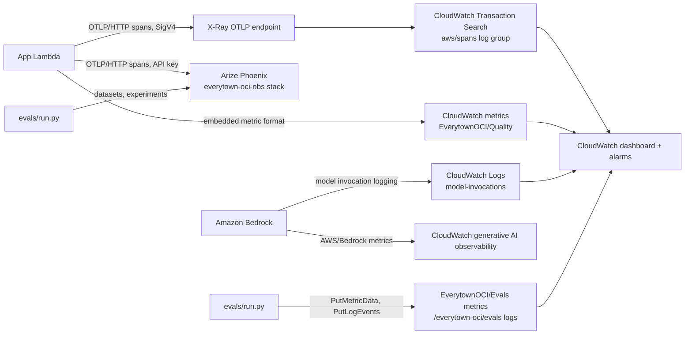

| AWS service | What it holds |
|---|---|
| **CloudWatch Transaction Search** (X-Ray) | One trace per report and per coach, staff or read-aloud request (service `everytown-oci`; eval runs are `everytown-oci-evals`). Spans use OpenInference and `gen_ai.*` attributes, so CloudWatch generative AI observability and Omni read the model calls. |
| **Bedrock model invocation logging** | Every Claude call's input and output text in `/aws/bedrock/everytown-oci/model-invocations` (14 days), behind the prebuilt Model Invocations view. |
| **CloudWatch metrics** | `AWS/Bedrock` (invocations, tokens, latency by model), `EverytownOCI/Quality` (`CheckScore` and `CheckFailed` by `Check`, from the code checks run on every live report) and `EverytownOCI/Evals` (`MeanScore` and `PassRate` by `Suite` and `Evaluator`, `GateFailures`, `CostUSD`). |
| **CloudWatch Logs** | `/everytown-oci/evals`: one event per eval example and one summary per run, for Logs Insights comparisons. |
| **CloudWatch dashboard and alarms** | Dashboard `everytown-oci` (stack output `DashboardUrl`); alarms `everytown-oci-report-grounding` (a live report failed the grounded check) and `everytown-oci-app-errors`. |
| **Arize Phoenix** (stack `everytown-oci-obs`) | The same traces in project `everytown-oci` (evals in `everytown-oci-evals`), plus eval datasets and experiments with every evaluator score. |

`scripts/deploy.sh` turns on the two account settings CloudFormation cannot (idempotent): Transaction Search (a CloudWatch Logs resource policy for X-Ray plus `update-trace-segment-destination CloudWatchLogs`, active about 10 minutes after the first time) and Bedrock model invocation logging to the stack's log group through `BedrockLoggingRole`. The Lambda has `OCI_TRACES=xray` and the `AWSXrayWriteOnlyAccess` managed policy; `observability.py` signs the OTLP requests itself (botocore SigV4), so there is no collector, layer or extra package. Locally, set `OCI_TRACES=xray` (CloudWatch) and/or `OCI_PHOENIX_ENDPOINT` plus `OCI_PHOENIX_API_KEY` (Phoenix) to trace a dev run; with neither, tracing is off.

#### Phoenix

`scripts/deploy_observability.sh` deploys Phoenix 21 (pinned image) on one t3.small EC2 instance with its SQLite data on an encrypted EBS volume, reachable only through its own CloudFront distribution (HTTPS, with Phoenix sign-in), about $22 a month. It writes secrets, the URL, the app's system API key and a sign-in to `infra/.phoenix.env` (git-ignored, mode 600); `scripts/deploy.sh` then passes `PHOENIX_URL` and `PHOENIX_API_KEY` to the Lambda (`OCI_PHOENIX_ENDPOINT`, `OCI_PHOENIX_API_KEY`), and `evals/run.py` reads the same file. `PHOENIX_SNAPSHOT_ID=snap-… scripts/deploy_observability.sh` on the first deploy restores the data volume from an earlier stack's final snapshot (v1.6 restored the v1.1 to v1.3 traces, datasets and experiments this way). Sign in at the stack output `PhoenixUrl` with `PHOENIX_LOGIN_EMAIL` and `PHOENIX_LOGIN_PASSWORD` from that file: an admin the script creates, because a restored volume keeps the old `admin@localhost` password. Each report stores both trace links (`trace.url` in Phoenix via `/redirects/traces/<id>`, `trace.cloudwatch_url` in the console), and staff see both; the online checks also land on the trace as Phoenix annotations, so they show in Phoenix's annotation columns.

#### What a trace shows

One trace per report (`session.id` = assessment id): `oci.report` → `score` (fixed engine, no model) → `research.website` / `research.social` / `research.news` and `research.summarize` → `library.kb_retrieve` (documents with scores) → `report.write` (Claude: prompts, raw tool output before validation, token and cache counts, stop reason, guardrail action) → `report.validate` (how many items the code dropped and why) → `report.plain_language` (grade before and after) → `online_checks` (the code checks from `evals/checks.py`, as attributes, CloudWatch metrics and Phoenix annotations on `oci.report`). Coach questions, staff "Ask the data", training briefs and read-aloud are traced too. Spans carry the user's role and a hashed session id, never the respondent's name. Staff open a report's trace from "View AI trace in Phoenix (staff)" or "View AI trace in CloudWatch (staff)" (each with its own sign-in); organizations never see them. Traces hold full prompts with synthetic data, so Phoenix and console access are the access control.

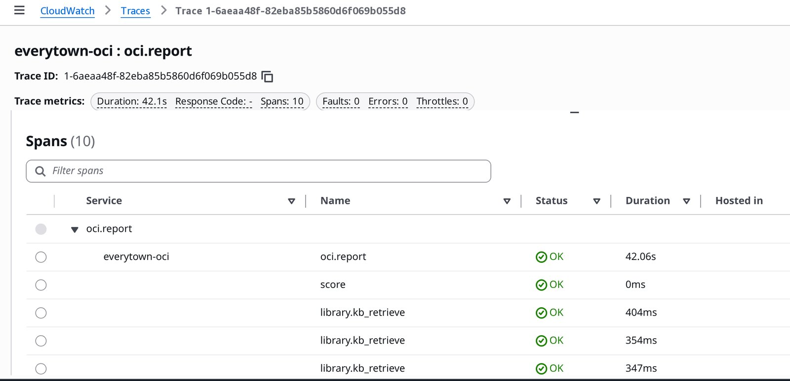

#### Evals

`evals/` runs the real AI steps on synthetic datasets (16 reports, 21 coach questions, 15 staff questions) and scores them with deterministic code checks (grounding, code-chosen focus, catalog-only links, crisis and score-change handling, staff-question rejection, reading level, language) and calibrated Claude Haiku judges (personalization, actionability, plain language and tone, faithfulness, coach helpfulness). Each run publishes its scores to CloudWatch metrics and logs and, when Phoenix is configured, runs as a Phoenix experiment on the uploaded dataset; `--compare` runs an A/B between models. The command exits nonzero when a gate check fails, so it can gate a release. See [`evals/README.md`](evals/README.md).

```
python3 -m evals.run --suite all --limit 4      # quick check, about $0.60
python3 -m evals.run --suite reports            # full reports suite, about $3
OCI_TRACES=xray python3 -m evals.run --suite coach --model us.anthropic.claude-haiku-5-5 --compare us.anthropic.claude-sonnet-5-5
```

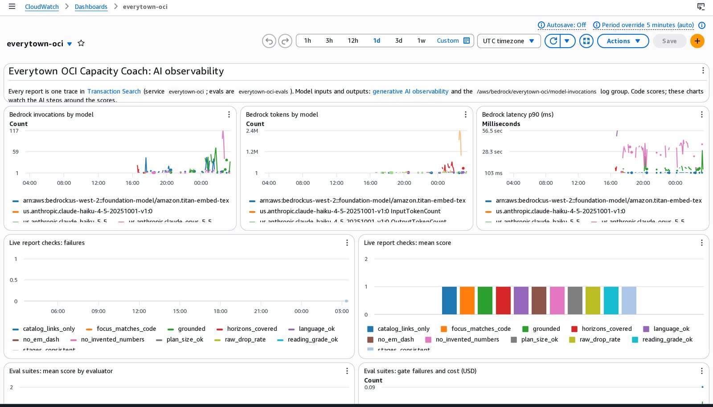

Cost at demo volume: CloudWatch Logs ingestion and storage for spans, invocation logs and eval logs is cents a month; a few custom metrics (about $0.30 each a month) and one dashboard ($3 a month); X-Ray and Transaction Search span indexing stay within the free tier at this traffic. The Phoenix EC2 server it replaces cost about $22 a month.

### End-to-end tests and bug bash (e2e)

`qa/` holds browser tests written with [e2e](https://e2e.com), the open source agentic test runner (Playwright underneath). Agent steps use Claude Sonnet on Amazon Bedrock through `@ai-sdk/amazon-bedrock`, with the standard AWS credentials; the regression tests themselves use exact locators and need no model. Needs Node 24.8 or newer.

```
cd qa && npm ci
docker run -d --name oci-qa -p 127.0.0.1:8092:8000 --env-file oci.env oci-coach   # the container from "Container", or any running copy
npm run test:e2e                     # sign-in setups, smoke tests and regressions/ against APP_URL (default http://127.0.0.1:8092)
npm run test:live                    # read-only checks against the deployed site (LIVE_URL)
```

A bug bash runs one `e2e explore` per charter in `qa/bugbash-charters.txt` (one area and one posture each: first-time user, edge input, numbers and copy, state, error paths), four at a time, with personas from `qa/e2e.bugbash.config.ts` (a skeptic that cross-checks every number, a fuzzer that runs the input matrix first). Every finding is a model's claim until a repro test fails for the reported reason; confirmed bugs become GitHub issues with the `bugbash` label, and each fixed repro test moves to `qa/tests/regressions/`. Install the e2e skill for the full procedure with `npx skills add tester-army/e2e` (`npx e2e guide bug-bash`).

The first bug bash (v1.3.0) ran 8 charters on the production build in the container (about 7.6M Bedrock tokens), plus an API fuzz of every route and a read of the sign-in code: 19 findings, 9 confirmed and fixed (issues #1 to #9, among them an open redirect on sign-in and 500 errors on non-object JSON bodies), 10 rejected with the reason (intended design, explorer artifacts, or not reproducible). axe-core found no WCAG 2.2 A or AA violations on any page or staff tab at 1280 and 375 px.

### Security notes

- Login is mocked (`demo` / `demo` for organizations, `staff` / `staff` for the Everytown dashboard), as the vision doc specifies, and the public URL is temporary: it is torn down after judging. Anyone signed in can open a report by its id, so this build is for synthetic data only. Re-assessment progress compares only within one sign-in session. Session cookies are signed, `HttpOnly`, `SameSite=Lax`, and `Secure` on AWS. POSTs must be JSON, which blocks cross-site form posts.
- The API can only be reached through CloudFront: the Lambda Function URL uses `AWS_IAM` auth with origin access control, so direct calls get 403. The browser sends `x-amz-content-sha256` for request bodies, as Lambda OAC requires.
- Spend guards: Lambda reserved concurrency of 10, at most `OCI_MAX_REPORTS_PER_HOUR` new reports per hour, and an optional monthly AWS Budget.
- Model output is checked for truncation and refusal (`stopReason`) before parsing; website text and the website profile are passed to the model as untrusted data.
- Amazon Bedrock Guardrails apply to every Claude call: content filters, prompt-attack blocking on input, and masking of emails, phone numbers, SSNs and card numbers. Staff training briefs receive only aggregated counts, never organization names.
- The database has no network ingress: the app reaches it only through the IAM-authorized RDS Data API; the password is an RDS-managed secret.
- The website fetch accepts only http(s) URLs whose host, and every redirect hop, resolves to a public IP.
- The model's output is untrusted: `validate_report` keeps only actions citing real gap ids and resources from the catalog.
- All responses in this repository are synthetic. Never commit real organization data or credentials. `api.md`, `.env` and `infra/.secret` are git-ignored.

---

## Resources

### Documentation

| | |
|---|---|
| [Technical guide](docs/technical-guide.md) ([PDF](docs/OCI-Capacity-Coach-technical-guide.pdf)) | The whole system in one document: architecture, data model, API, AI pipeline, operations. |
| [Vision](docs/vision.md) · [Tech brief](docs/tech.md) | The hackathon brief this build answers. |
| [Next steps](docs/next-steps.md) | Known limits and what a pilot needs. |
| [Features and benefits](docs/features-and-benefits.md) | Every feature we added for Everytown, and what it gives leaders, staff and Everytown. |
| [Pitch deck](docs/pitch/OCI-Capacity-Coach-pitch.pdf) · [demo script](docs/pitch/demo-script.md) · [sample report](docs/pitch/sample-report.pdf) | The 7-minute presentation and the live demo, click by click. |
| [Demo video](docs/demo/oci-capacity-coach-demo.mp4) | The recording at the top of this page. |
| [CHANGELOG.md](CHANGELOG.md) · [Releases](https://github.com/ArielleTolome/everytown-oci/releases) · [Deployments](https://github.com/ArielleTolome/everytown-oci/deployments) · [Packages](https://github.com/ArielleTolome/everytown-oci/pkgs/container/everytown-oci) | What changed, what is live, and the container image. |
| Folder READMEs ([`evals/`](evals/README.md), [`qa/`](qa/README.md), [`frontend/`](frontend/README.md), [`scripts/`](scripts/README.md), ...) | Every file and what it does. |

### Layout

Each folder has its own `README.md` that lists every file and what it does; working rules for teammates and AI assistants are in [AGENTS.md](AGENTS.md) (Claude Code reads it through `CLAUDE.md`).

| Path | Purpose |
|---|---|
| `app.py` | Flask JSON API: auth (mocked roles), validation, scoring, progress comparison, job dispatch (thread or async Lambda), staff analytics. |
| `serve.py`, `Dockerfile`, `.github/workflows/package.yml` | Container image: the API plus the built site on one port, published to GitHub Packages on each release tag. |
| `db.py`, `schema.sql` | Aurora Data API layer, analytics queries, `migrate` (schema.sql plus `features/*.sql`) and `seed` CLI. |
| `features/` | Feature modules, each a Flask Blueprint auto-registered by `app.py`: `coach.py` (Chat about your report), `tts.py` (Polly audio), `drafts.py` (save, resume, share an area), `orgmeta.py` (organization details, respondent roles, budgets), `staff_ai.py` (training briefs), `milestones.py` (12-week roadmap, gamification, weekly PDF), `bi.py` (staff BI, Ask the data, network report PDF), `peers.py` (similarity and peer groups), `peers_request.py` (connect requests). |
| `frontend/public/content/` | `glossary.json` and `questions_es.json`, generated once offline by `scripts/gen_content.py` and reviewed (re-running it overwrites the manual fixes); `ladders.json` (laddered statements asked as one multiple-choice question) and `sample_answers.json` (synthetic demo answers). |
| `pipeline.py` | Website research, Knowledge Base retrieval, structured report generation and its validation. |
| `observability.py` | OpenTelemetry tracing to AWS X-Ray and Arize Phoenix (OpenInference and `gen_ai` attributes), the staff trace link, and online-check metrics in CloudWatch embedded metric format. |
| `lambda_handler.py` | Lambda entry point: web requests to Flask, `{"oci_sid": ...}` events to the pipeline. |
| `report.py` | PDF report, mirroring the sample reports' layout plus the AI sections. |
| `frontend/` | Astro 5 static site (TypeScript, no UI framework) in Everytown colors. Fonts in `frontend/public/fonts/` (Atkinson Hyperlegible, Source Serif 4 and Noto Sans Math, all OFL) are also used by the PDF. |
| `resources/catalog.json` | The only links the model may recommend (19 vetted resources). |
| `resources/library/*.md` | Field guides per OCI domain, ingested into the Knowledge Base. |
| `data/questions.json` | 143 statements across 8 domains, plus stage and domain weights. |
| `data/domain_info.json` | Domain descriptions and stage definitions from the questionnaires. |
| `data/samples.json` | Metadata for the three synthetic sample organizations (answers come from `benchmark/`). |
| `engine/`, `utils/`, `benchmark/`, `verify_benchmark.py` | Reference scoring engine, loader, synthetic answer key and checker. |
| `infra/template.yaml`, `infra/database.yaml`, `scripts/` | CloudFormation (app and database stacks) and build/deploy scripts. |
| `tests/` | Unit tests: model-output grounding and Start-here selection, reading level and rewrite checks, guardrail handling, coach validation and limits, drafts merge rules, re-assessment comparison. |
| `docs/pitch/` | Hackathon pitch deck (open `index.html`, arrow keys, `n` for notes) and demo script. |
| `docs/img/`, `docs/demo/`, `scripts/build_readme_media.py` | This README's banner (`banner.html` rendered to `banner.png`) and the demo video (MP4, plus the GIF shown at the top), rebuilt by `python3 scripts/build_readme_media.py banner` or `demo`. |
| `PRODUCT.md` | Product context for design work (users, purpose, constraints, brand commitments), read by the impeccable design skill. |
| `qa/` | End-to-end tests and bug bash with [e2e](https://e2e.com) (see [End-to-end tests](#end-to-end-tests-and-bug-bash-e2e)). |

### Release process

Every update ships with:

1. This README, updated to match the new behaviour.
2. A new section in `CHANGELOG.md`.
3. A git tag `vX.Y.Z` and a GitHub release whose notes are that changelog section.

### License

Apache License 2.0, see [LICENSE](LICENSE).
