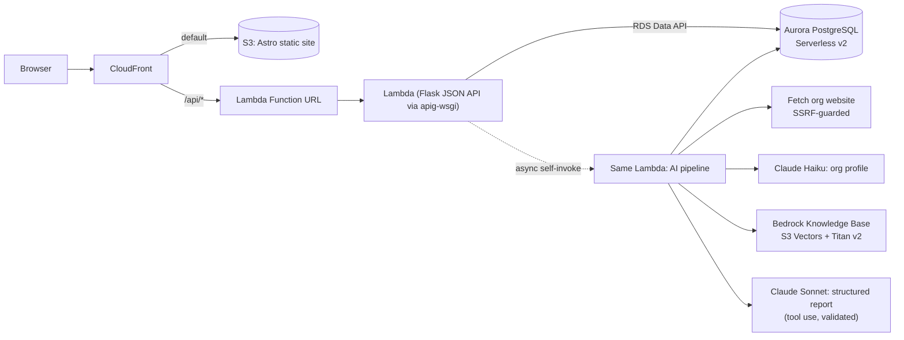

# OCI Capacity Coach (Everytown OCI Platform)

The Organizational Capacity Index (OCI) for community violence intervention (CVI) nonprofits in Everytown's Community Safety Fund network. An organization's leader signs in, answers a Yes/No self-assessment, and gets a plain-language report: what is true about the organization today, the one or two priorities to start with, and a 30 / 60 / 90 day plan, on screen and as a PDF. Everytown staff get a network dashboard that shows which training and services grantees need and which grantees share the same problems, so they can be connected.

- Deterministic Python code computes every score. The engine is the reference implementation, unchanged, and `verify_benchmark.py` proves it against the answer key.
- Claude on Amazon Bedrock writes the coaching narrative around those fixed scores. The server then validates the output: every action must cite real growth priorities from this submission, and every link must come from the curated resource catalog.

AWS Breaking Barriers 2026 hackathon build. Full brief: [`docs/vision.md`](docs/vision.md), [`docs/tech.md`](docs/tech.md).

**Current release:** v0.5.0. See [CHANGELOG.md](CHANGELOG.md) and the GitHub Releases page. Pitch deck: [`docs/pitch/index.html`](docs/pitch/index.html); demo script: [`docs/pitch/demo-script.md`](docs/pitch/demo-script.md).

## Vision

The manual 2025 pilot helped 45 organizations, but two CSF staff wrote every report by hand, so it could not reach the 140+ organization network. The Capacity Coach turns that into a five-minute-per-domain self-service flow, so CSF staff can spend their time on coaching instead of report writing.

Design principles, taken from the builder package:

| Principle | Source | How the product applies it |
|---|---|---|
| A learning tool, not an evaluation | OCI handoff deck: "a learning experience, not an evaluative one" | Results lead with the stage ladder (Seeding to Transformational); percentages come second. Gaps are called "growth priorities". |
| Reduce burden | Handoff deck design specifications | You choose which areas to assess today. Answers are kept per area. The website is optional. |
| Actionable within weeks | Vision doc success metric | A 30 / 60 / 90 day plan with a role owner for each action (BJA checklist 3.2: tasks, deadlines, people responsible). |
| Team reflection | Handoff deck speaker notes | A "Team conversation guide" for the next leadership meeting. |
| Grounded, never invented | Tech doc: the LLM never scores | Server-side grounding validation; resource links only from `resources/catalog.json`. |
| Accessible to everyone | Community Empowerment track | WCAG 2.2 AA, Atkinson Hyperlegible font, larger-text and high-contrast modes, read-aloud, Spanish reports. |
| Readable at an 8th grade level | Everytown interview: "I can read this even though I'm at an 8th grade reading level and I've been to prison" | The prompt writes for leaders of 5 to 20 person groups with lived experience: short sentences, everyday words. |
| One or two things first | Everytown interview: "out of the 10 things you could fix, here's one or two priorities that you should do first" | A validated "Start here" section with at most two grounded priorities, before the full plan. |
| Learn across the network | Everytown interview: "if 50 or 75 or 100 of them take this assessment... I know what training they need"; "identify groups of grantees with similar problems that we could connect" | Aurora PostgreSQL stores every assessment; the staff dashboard shows stage distributions, the most common growth priorities, and "Grantees to connect" cohorts. |
| Benchmarking later, never for grantees | Everytown interview (future capability) and handoff deck ("no external benchmarking") | A `domain_benchmarks` SQL view ranks organizations per domain; only the staff dashboard shows it, labelled as a preview. |

## Quick start (local)

Requires Python 3.9+, Node 20+, AWS credentials with Bedrock access to Anthropic Claude, and the database stack (`everytown-oci-db`, created by `scripts/deploy.sh`). Local and cloud share the same Aurora database through the RDS Data API, so there is no local database to install.

```
pip install -r requirements.txt
export AWS_DEFAULT_REGION=us-west-2 AWS_ACCESS_KEY_ID=... AWS_SECRET_ACCESS_KEY=... AWS_SESSION_TOKEN=...
export OCI_DB_CLUSTER_ARN=... OCI_DB_SECRET_ARN=...     # outputs of the everytown-oci-db stack
python3 -m db migrate && python3 -m db seed              # schema + 20 synthetic organizations
python3 app.py                                            # JSON API on :8000
cd frontend && npm ci && npm run dev                      # Astro on :4321, proxies /api to :8000
```

Open http://127.0.0.1:4321 and sign in with `demo` / `demo` (organization leader) or `staff` / `staff` (Everytown staff dashboard). Locally the AI steps run in a background thread. Without `OCI_KB_ID`, the whole field-guide library is injected into the prompt.

Checks:

```
python3 verify_benchmark.py                 # expect three PASS lines
python3 -m unittest discover -s tests       # grounding validation and re-assessment comparison
cd frontend && npx astro check && npm run build
```

## User journey

1. Sign in with the mocked credentials.
2. Enter the organization name and, optionally, its website. Choose the report language (English or Español) and the areas to assess. The four priority areas (Planning, Fundraising, Financial Management, ML&E) are pre-selected. Or open "Try a synthetic sample organization" to submit one of the three fictional organizations from the builder package in one click (for demos and staff training).
3. Answer one area per screen. Each area must be fully answered before you move on, because an unanswered statement would count as favorable. Back keeps your answers.
4. The results page shows the stage ladder and scores immediately, then live progress through: reading answers, scoring, researching the website, consulting the CVI resource library, and writing recommendations. If a step fails, "Try again" reruns only the AI steps.
5. Read "What's true about you", then "Start here: your top priorities" (one or two, each showing the statements it is based on, what to do, and a vetted resource), then strengths, the 30 / 60 / 90 day plan, team conversation guide and all growth priorities. Listen to any section aloud, then download the PDF.
6. Reassess later under the same organization name: the results page and PDF show "Progress since your last assessment", with growth priorities closed, new ones, and stage moves per area. The comparison is deterministic and covers only the areas both assessments included; the AI summary celebrates it first.
7. Everytown staff sign in as `staff` and open the network dashboard: totals, stage distribution per area (bars plus an equivalent table), the most common growth priorities (training and service needs), "Grantees to connect" cohorts sharing a High priority growth priority, and an organizations table with a staff-only peer percentile preview. Filter by area and download CSV.

## Architecture



The pipeline is hardcoded, not agentic, as the tech doc prefers:

| Step | Code | Model |
|---|---|---|
| Score | `engine/scoring.py` (unchanged reference implementation) | none |
| Research the website | `pipeline.research_org` | `OCI_FAST_MODEL_ID` (Claude Haiku) |
| Consult the CVI library | `pipeline.gather_library`: one Knowledge Base retrieval per assessed area, queried with its top growth priorities | Titan Text Embeddings v2 |
| Write the report | `pipeline.write_report`: Converse tool use with a JSON schema, then `validate_report` drops ungrounded actions and unknown links | `OCI_MODEL_ID` (Claude Sonnet) |
| Render | `frontend/src/pages/results.astro` + `frontend/src/lib/results.ts`, `report.py` (fpdf2, Unicode TTF, bookmarks, PDF language tag) | none |

Why Lambda instead of the Fargate stretch goal: CloudFront cannot reach a Fargate task without a load balancer, and App Runner is closed to new customers. One Lambda behind CloudFront scales to zero and needs no VPC or NAT, because it reaches Aurora through the HTTPS Data API.

Why Aurora PostgreSQL Serverless v2: the Everytown interview asked for network analytics over time, which is relational work (joins across organizations, assessments, growth priorities). Managed RDS gives backups, patching and encryption that a self-hosted database on EC2 would need by hand, and Oracle would add licensing cost for no benefit. The vision doc originally listed a relational database as out of scope; the interview changed that.

### Data model (`schema.sql`)

| Table / view | Purpose |
|---|---|
| `organizations` | One row per organization, matched by normalized name (login is mocked). |
| `assessments` | One row per submission: `source` (web, demo, seed), status, and the full rendered document as `jsonb`. |
| `answers`, `domain_results`, `gaps` | Normalized deterministic results for analytics. Written once at submit, never by the model. |
| `latest_assessments` (view) | Each organization's most recent assessment: the unit for network analytics. |
| `domain_benchmarks` (view) | Peer percentile per organization and domain. Staff only; future benchmarking. |

## Deploying to AWS

Two CloudFormation stacks:
- `everytown-oci-db` (`infra/database.yaml`): Aurora PostgreSQL Serverless v2 with the RDS Data API and an RDS-managed secret. Data lifecycle is independent of the app.
- `everytown-oci` (`infra/template.yaml`): CloudFront serving the Astro static site from a private S3 bucket (origin access control) and routing `/api/*` to one Python 3.12 Lambda (Flask JSON API via apig-wsgi, plus an async self-invoke for the AI pipeline), Bedrock Knowledge Base on S3 Vectors over `resources/library/*.md`, IAM roles. No Cognito, load balancer, WAF, custom KMS keys or NAT.

Requirements: AWS CLI v2, Python 3 with pip and boto3, Node 20+, `zip`, credentials in the environment, Bedrock model access for Anthropic Claude and Titan Text Embeddings v2.

```
scripts/deploy.sh                      # db stack, site build, Lambda zip, app stack, site sync + invalidation, db migrate/seed, KB ingest
DB_MIN_CAPACITY=0 scripts/deploy.sh    # Aurora auto-pause after 1 idle hour (about 15 s resume on the next request)
```

Optional env: `STACK`, `DB_STACK`, `AWS_REGION`, `EXTRA_DOCS` (extra public Knowledge Base documents). The script is idempotent: the Lambda zip is uploaded under a content-hash key to `oci-artifacts-<account>-<region>`, the Flask session secret is generated once into `infra/.secret` (git-ignored), and fingerprinted `_astro/*` assets get a one-year cache while HTML is always revalidated. Cost: about $45 a month at the 0.5 ACU Aurora minimum (kept warm for the hackathon), about $1 to $3 a month with auto-pause, plus roughly $0.05 to $0.10 of Bedrock tokens per report. Tear down: `aws cloudformation delete-stack --stack-name everytown-oci` (empty the site and docs buckets first), then `everytown-oci-db` (keeps a final snapshot).

## Configuration

| Variable | Default | Purpose |
|---|---|---|
| `OCI_DOMAINS` | `PL,FR,FM,ML` | Areas pre-selected on the organization form. Choose from PL, FR, GV, HR, FM, ML, CE, TI. |
| `OCI_MODEL_ID` | `us.anthropic.claude-sonnet-5-5` | Bedrock model or inference profile for the report. |
| `OCI_FAST_MODEL_ID` | `us.anthropic.claude-haiku-5-5` | Model for the website profile. |
| `OCI_KB_ID` | unset | Bedrock Knowledge Base ID. Unset means the library is injected into the prompt. |
| `OCI_DB_CLUSTER_ARN`, `OCI_DB_SECRET_ARN` | required | Aurora cluster and its RDS-managed secret (Data API). |
| `OCI_DB_NAME` | `oci` | Database name. |
| `OCI_WORKER_FN` | unset | Lambda function to invoke asynchronously for the AI steps. Unset means a background thread. |
| `OCI_SECRET_KEY` | random per start | Flask session key. Set it to keep users signed in across restarts. |
| `PORT` | `8000` | Local API port. |

## Layout

| Path | Purpose |
|---|---|
| `app.py` | Flask JSON API: auth (mocked roles), validation, scoring, progress comparison, job dispatch (thread or async Lambda), staff analytics. |
| `db.py`, `schema.sql` | Aurora Data API layer, analytics queries, `migrate` and `seed` CLI. |
| `pipeline.py` | Website research, Knowledge Base retrieval, structured report generation and its validation. |
| `lambda_handler.py` | Lambda entry point: web requests to Flask, `{"oci_sid": ...}` events to the pipeline. |
| `report.py` | PDF report, mirroring the sample reports' layout plus the AI sections. |
| `frontend/` | Astro 5 static site (TypeScript, no UI framework) in Everytown colors. Fonts in `frontend/public/fonts/` (Atkinson Hyperlegible and Noto Sans Math, both OFL) are also used by the PDF. |
| `resources/catalog.json` | The only links the model may recommend (19 vetted resources). |
| `resources/library/*.md` | Field guides per OCI domain, ingested into the Knowledge Base. |
| `data/questions.json` | 143 statements across 8 domains, plus stage and domain weights. |
| `data/domain_info.json` | Domain descriptions and stage definitions from the questionnaires. |
| `data/samples.json` | Metadata for the three synthetic sample organizations (answers come from `benchmark/`). |
| `engine/`, `utils/`, `benchmark/`, `verify_benchmark.py` | Reference scoring engine, loader, synthetic answer key and checker. |
| `infra/template.yaml`, `infra/database.yaml`, `scripts/` | CloudFormation (app and database stacks) and build/deploy scripts. |
| `tests/` | Unit tests for the model-output grounding rules and the re-assessment comparison. |
| `docs/pitch/` | Hackathon pitch deck (open `index.html`, arrow keys, `n` for notes) and demo script. |

## Scoring

A statement is a gap when `answer == trigger_on`.

```
gap_density_bonus = 1 + gaps_in_domain / statements_in_domain     # 1.0 .. 2.0
priority_score    = stage_weight * domain_weight * gap_density_bonus
```

- Stage weight runs from 5 (Seeding) down to 1 (Transformational). Domain weight runs from 0.7 to 1.0.
- Priority bands (High, Medium, Low) are percentile thirds of all gaps in *this* submission. They are relative, so assessing 4 areas instead of 8 can move a gap into a different band. Capacity percentages and stages are per domain and do not change.
- An unanswered statement would count as favorable, so the app requires every statement to be answered.
- `PL1` is reverse-coded (`trigger_on: "yes"`).

## Accessibility

- Semantic HTML: landmarks, skip link, one `<fieldset>`/`<legend>` per statement, native radios and checkboxes, real `<table>` with caption.
- Error summaries that take focus and link to each field; per-field errors tied with `aria-describedby`.
- Live processing status in a polite live region that announces only step changes; focus moves to "Your report is ready".
- Atkinson Hyperlegible (designed for low-vision readers), Display menu for larger text and high contrast, `prefers-reduced-motion` respected, 44px targets.
- AI-written text is marked with its language (`lang="es"`), so screen readers switch voice. Read-aloud buttons use the browser's speech synthesis.
- The PDF uses real text, bookmarks per section, a document language and title.
- Checked with axe-core (WCAG 2.0/2.1/2.2 A and AA rules): no violations on login, organization, questionnaire, processing and report pages.

## Security notes

- Login is mocked (`demo` / `demo` for organizations, `staff` / `staff` for the Everytown dashboard), as the vision doc specifies. Anyone signed in can open a report by its id, and organizations are matched by name, so this build is for synthetic data only. Session cookies are signed, `HttpOnly`, `SameSite=Lax`, and `Secure` on AWS. POSTs must be JSON, which blocks cross-site form posts.
- The database has no network ingress: the app reaches it only through the IAM-authorized RDS Data API; the password is an RDS-managed secret.
- The website fetch accepts only http(s) URLs whose host, and every redirect hop, resolves to a public IP.
- The model's output is untrusted: `validate_report` keeps only actions citing real gap ids and resources from the catalog.
- All responses in this repository are synthetic. Never commit real organization data or credentials. `api.md`, `.env` and `infra/.secret` are git-ignored.

## Release process

Every update ships with:

1. This README, updated to match the new behaviour.
2. A new section in `CHANGELOG.md`.
3. A git tag `vX.Y.Z` and a GitHub release whose notes are that changelog section.
