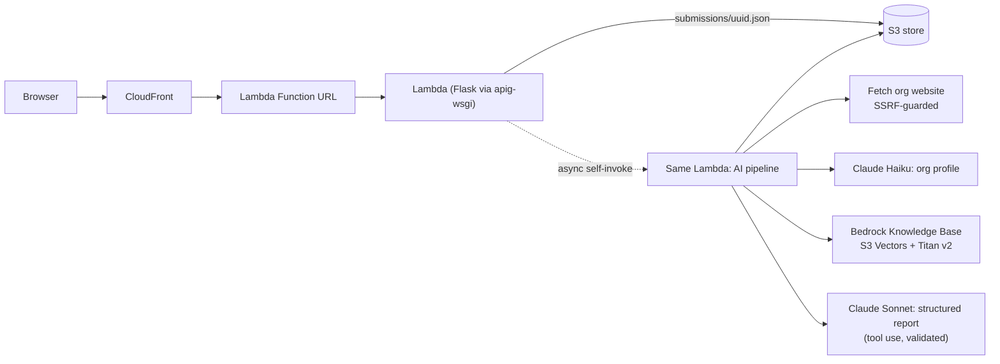

# OCI Capacity Coach (Everytown OCI Platform)

The Organizational Capacity Index (OCI) for community violence intervention (CVI) nonprofits in Everytown's Community Safety Fund network. An organization signs in, answers a Yes/No self-assessment, and gets a personalized 30 / 60 / 90 day action plan on screen and as a PDF.

- Deterministic Python code computes every score. The engine is the reference implementation, unchanged, and `verify_benchmark.py` proves it against the answer key.
- Claude on Amazon Bedrock writes the coaching narrative around those fixed scores. The server then validates the output: every action must cite real growth priorities from this submission, and every link must come from the curated resource catalog.

AWS Breaking Barriers 2026 hackathon build. Full brief: [`docs/vision.md`](docs/vision.md), [`docs/tech.md`](docs/tech.md).

**Current release:** v0.3.0. See [CHANGELOG.md](CHANGELOG.md) and the GitHub Releases page.

## Vision

The manual 2025 pilot helped 45 organizations, but two CSF staff wrote every report by hand, so it could not reach the 140+ organization network. The Capacity Coach turns that into a five-minute-per-domain self-service flow, so CSF staff can spend their time on coaching instead of report writing.

Design principles, taken from the builder package:

| Principle | Source | How the product applies it |
|---|---|---|
| A learning tool, not an evaluation | OCI handoff deck: "a learning experience, not an evaluative one" | Results lead with the stage ladder (Seeding to Transformational); percentages come second. Gaps are called "growth priorities". |
| Reduce burden | Handoff deck design specifications | You choose which areas to assess today. Answers are kept per area. The website is optional. |
| Actionable within weeks | Vision doc success metric | A 30 / 60 / 90 day plan with a role owner for each action (BJA checklist 3.2: tasks, deadlines, people responsible). |
| Team reflection | Handoff deck speaker notes | A "Team conversation guide" for the next leadership meeting. |
| Grounded, never invented | Tech doc: the LLM never scores | Server-side grounding validation; resource links only from `resources/catalog.json`. |
| Accessible to everyone | Community Empowerment track | WCAG 2.2 AA, Atkinson Hyperlegible font, larger-text and high-contrast modes, read-aloud, Spanish reports. |

## Quick start (local)

Requires Python 3.9+ and AWS credentials for an account with Bedrock access to Anthropic Claude (us-west-2 sandbox).

```
pip install -r requirements.txt
export AWS_DEFAULT_REGION=us-west-2 AWS_ACCESS_KEY_ID=... AWS_SECRET_ACCESS_KEY=... AWS_SESSION_TOKEN=...
python3 app.py
```

Open http://127.0.0.1:8000 and sign in with `demo` / `demo`. Locally, submissions are JSON files in `instance/submissions/` and the AI steps run in a background thread. Without `OCI_KB_ID`, the whole field-guide library is injected into the prompt.

Checks (standard library only):

```
python3 verify_benchmark.py                 # expect three PASS lines
python3 -m unittest discover -s tests       # grounding validation of the model's output
```

## User journey

1. Sign in with the mocked credentials.
2. Enter the organization name and, optionally, its website. Choose the report language (English or Español) and the areas to assess. The four priority areas (Planning, Fundraising, Financial Management, ML&E) are pre-selected.
3. Answer one area per screen. Each area must be fully answered before you move on, because an unanswered statement would count as favorable. Back keeps your answers.
4. The results page shows the stage ladder and scores immediately, then live progress through: reading answers, scoring, researching the website, consulting the CVI resource library, and writing recommendations. If a step fails, "Try again" reruns only the AI steps.
5. Read the summary, strengths, 30 / 60 / 90 day plan (each action shows the statements it is based on and a vetted resource), team conversation guide and all growth priorities. Listen to any section aloud, then download the PDF.

## Architecture



The pipeline is hardcoded, not agentic, as the tech doc prefers:

| Step | Code | Model |
|---|---|---|
| Score | `engine/scoring.py` (unchanged reference implementation) | none |
| Research the website | `pipeline.research_org` | `OCI_FAST_MODEL_ID` (Claude Haiku) |
| Consult the CVI library | `pipeline.gather_library`: one Knowledge Base retrieval per assessed area, queried with its top growth priorities | Titan Text Embeddings v2 |
| Write the report | `pipeline.write_report`: Converse tool use with a JSON schema, then `validate_report` drops ungrounded actions and unknown links | `OCI_MODEL_ID` (Claude Sonnet) |
| Render | `templates/results.html`, `report.py` (fpdf2, Unicode TTF, bookmarks, PDF language tag) | none |

Why Lambda instead of the Fargate stretch goal: CloudFront cannot reach a Fargate task without a load balancer (out of scope), and App Runner is closed to new customers. One Lambda behind CloudFront scales to zero, needs no VPC or NAT, and costs about $0 to $1 a month at demo traffic, plus roughly $0.05 to $0.10 of Bedrock tokens per report.

## Deploying to AWS

Everything is plain CloudFormation in `infra/template.yaml`: S3 store, Lambda + Function URL, CloudFront, Bedrock Knowledge Base on S3 Vectors with a docs bucket, and IAM roles. No Cognito, database, load balancer, WAF, KMS, Secrets Manager or NAT.

Requirements: AWS CLI v2, Python 3 with pip, `zip`, credentials in the environment, and Bedrock model access for Anthropic Claude and Titan Text Embeddings v2.

```
scripts/deploy.sh            # build, upload, deploy stack, sync + ingest library, print AppUrl
STACK=oci-demo AWS_REGION=us-west-2 EXTRA_DOCS=/path/to/public/docs scripts/deploy.sh
```

`scripts/build.sh` builds `build/oci.zip` with manylinux wheels for python3.12/x86_64. `deploy.sh` is idempotent: it creates `oci-artifacts-<account>-<region>` if needed, uploads the zip under a content-hash key, generates a session secret once into `infra/.secret` (git-ignored), runs `aws cloudformation deploy`, syncs `resources/library/*.md` (and `$EXTRA_DOCS`) to the docs bucket, and waits for the Knowledge Base ingestion job. Only put public documents in `EXTRA_DOCS`. Tear down with `aws cloudformation delete-stack --stack-name everytown-oci` after emptying the store and docs buckets.

## Configuration

| Variable | Default | Purpose |
|---|---|---|
| `OCI_DOMAINS` | `PL,FR,FM,ML` | Areas pre-selected on the organization form. Choose from PL, FR, GV, HR, FM, ML, CE, TI. |
| `OCI_MODEL_ID` | `us.anthropic.claude-sonnet-5-5` | Bedrock model or inference profile for the report. |
| `OCI_FAST_MODEL_ID` | `us.anthropic.claude-haiku-5-5` | Model for the website profile. |
| `OCI_KB_ID` | unset | Bedrock Knowledge Base ID. Unset means the library is injected into the prompt. |
| `OCI_BUCKET` | unset | S3 bucket for submissions. Unset means local JSON files. |
| `OCI_WORKER_FN` | unset | Lambda function to invoke asynchronously for the AI steps. Unset means a background thread. |
| `OCI_SECRET_KEY` | random per start | Flask session key. Set it to keep users signed in across restarts. |
| `PORT` | `8000` | Local HTTP port. |

## Layout

| Path | Purpose |
|---|---|
| `app.py` | Flask routes, validation, S3 or local JSON store, job dispatch (thread or async Lambda). |
| `pipeline.py` | Website research, Knowledge Base retrieval, structured report generation and its validation. |
| `lambda_handler.py` | Lambda entry point: web requests to Flask, `{"oci_sid": ...}` events to the pipeline. |
| `report.py` | PDF report, mirroring the sample reports' layout plus the AI sections. |
| `templates/`, `static/` | Accessible server-rendered UI (no build step). Fonts: Atkinson Hyperlegible and Noto Sans Math, both OFL. |
| `resources/catalog.json` | The only links the model may recommend (19 vetted resources). |
| `resources/library/*.md` | Field guides per OCI domain, ingested into the Knowledge Base. |
| `data/questions.json` | 143 statements across 8 domains, plus stage and domain weights. |
| `data/domain_info.json` | Domain descriptions and stage definitions from the questionnaires. |
| `engine/`, `utils/`, `benchmark/`, `verify_benchmark.py` | Reference scoring engine, loader, synthetic answer key and checker. |
| `infra/template.yaml`, `scripts/` | CloudFormation and build/deploy scripts. |
| `tests/` | Unit test for the model-output grounding rules. |

## Scoring

A statement is a gap when `answer == trigger_on`.

```
gap_density_bonus = 1 + gaps_in_domain / statements_in_domain     # 1.0 .. 2.0
priority_score    = stage_weight * domain_weight * gap_density_bonus
```

- Stage weight runs from 5 (Seeding) down to 1 (Transformational). Domain weight runs from 0.7 to 1.0.
- Priority bands (High, Medium, Low) are percentile thirds of all gaps in *this* submission. They are relative, so assessing 4 areas instead of 8 can move a gap into a different band. Capacity percentages and stages are per domain and do not change.
- An unanswered statement would count as favorable, so the app requires every statement to be answered.
- `PL1` is reverse-coded (`trigger_on: "yes"`).

## Accessibility

- Semantic HTML: landmarks, skip link, one `<fieldset>`/`<legend>` per statement, native radios and checkboxes, real `<table>` with caption.
- Error summaries that take focus and link to each field; per-field errors tied with `aria-describedby`.
- Live processing status in a polite live region that announces only step changes; focus moves to "Your report is ready".
- Atkinson Hyperlegible (designed for low-vision readers), Display menu for larger text and high contrast, `prefers-reduced-motion` respected, 44px targets.
- AI-written text is marked with its language (`lang="es"`), so screen readers switch voice. Read-aloud buttons use the browser's speech synthesis.
- The PDF uses real text, bookmarks per section, a document language and title.
- Checked with axe-core (WCAG 2.0/2.1/2.2 A and AA rules): no violations on login, organization, questionnaire, processing and report pages.

## Security notes

- Login is mocked (`demo` / `demo`), as the vision doc specifies. Session cookies are signed, `SameSite=Lax`, and `Secure` on AWS.
- The website fetch accepts only http(s) URLs whose host, and every redirect hop, resolves to a public IP.
- The model's output is untrusted: `validate_report` keeps only actions citing real gap ids and resources from the catalog.
- All responses in this repository are synthetic. Never commit real organization data or credentials. `api.md`, `.env` and `infra/.secret` are git-ignored.

## Release process

Every update ships with:

1. This README, updated to match the new behaviour.
2. A new section in `CHANGELOG.md`.
3. A git tag `vX.Y.Z` and a GitHub release whose notes are that changelog section.
