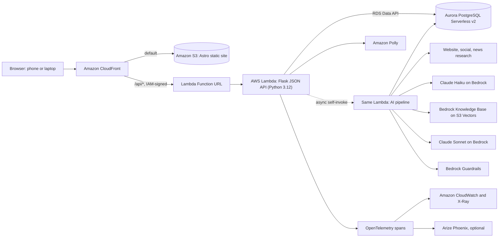

# OCI Capacity Coach: Technical Guide

**Everytown Community Safety Fund · Organizational Capacity Index · AWS Breaking Barriers 2026**

This guide explains the whole system we built: what it does, how every part works, why we made each choice, how it is deployed, tested and observed, and how it grew release by release from the first commit (v0.1.0, 2026-11-03) to v1.9.0 (2026-11-04). It is written for the team, for Everytown's technical staff who may take it over, and for anyone reviewing the code.

Where a section only summarizes, it links to the file or folder guide that holds the detail. Every folder has its own `README.md` listing each file.

---

## Contents

1. [The project in one page](#1-the-project-in-one-page)
2. [Architecture](#2-architecture)
3. [Repository map](#3-repository-map)
4. [The assessment and the scoring engine](#4-the-assessment-and-the-scoring-engine)
5. [Data model](#5-data-model)
6. [The API](#6-the-api)
7. [The AI report pipeline](#7-the-ai-report-pipeline)
8. [Features around the report](#8-features-around-the-report)
9. [The staff dashboard](#9-the-staff-dashboard)
10. [The frontend](#10-the-frontend)
11. [Infrastructure and deployment](#11-infrastructure-and-deployment)
12. [Security and privacy](#12-security-and-privacy)
13. [Observability](#13-observability)
14. [Quality: tests, evals and end-to-end checks](#14-quality-tests-evals-and-end-to-end-checks)
15. [How we built it](#15-how-we-built-it)
16. [Release history](#16-release-history)
17. [Operating the system](#17-operating-the-system)
18. [Known limits and next steps](#18-known-limits-and-next-steps)
19. [Glossary](#19-glossary)

---

## 1. The project in one page

**The problem.** Everytown's Community Safety Fund (CSF) funds and supports community violence intervention (CVI) organizations: the people who stop shootings in their own neighborhoods. In 2025, 45 organizations took the Organizational Capacity Index (OCI), a self-assessment of 143 Yes / No statements across 8 areas, and two CSF staff wrote every individualized report by hand. The network is more than 140 organizations, and CSF plans to open the tool to any CVI group.

**What we built.** The OCI Capacity Coach:

- **For the organization's leader:** a short start page, the 143 statements in three answer styles (one at a time, Yes / No list, checklist), in English or Spanish, on a laptop or a phone. Scores and stages appear at once from Everytown's own scoring rules. About 40 seconds later, an AI-written report reads like a letter from a coach: what is true about you, one or two things to start with, a 30 / 60 / 90 day plan, a 12-week roadmap with weekly steps, a PDF for the board, read-aloud, and questions about the report.
- **For CSF staff:** a network dashboard: who needs which training, gaps by area, change over time, plain-English questions answered from fixed analyses ("Ask the data"), similar organizations to connect, report quality and follow-through, opt-ins, and where people stop.

**The rules that never bend.**

- Code computes every score and stage. The AI never scores, never picks the priorities, never writes SQL and never computes a number staff see.
- Every recommended action must cite the organization's own answers, and links come only from a vetted catalog. Anything else is removed before anyone sees it.
- Fixed AI steps, not agents. AWS only, Claude on Amazon Bedrock only, synthetic data only.
- Plain language (reading grade 8.5 or below, measured in code), WCAG 2.2 AA, English and Spanish.

**By the numbers (v1.9.0).**

| | |
|---|---|
| Statements / areas / stages | 143 / 8 / 5 |
| Python (API, pipeline, features, scripts, tests, evals) | about 8,900 lines |
| Frontend (TypeScript, Astro, CSS) | about 7,300 lines |
| Unit tests | 150 |
| End-to-end tests | 49 tests, each run on desktop and phone (98 runs) |
| AI eval cases | 52 (16 reports, 21 coach questions, 15 staff questions) plus 20 judge calibration cases |
| Releases | 27 tags, v0.1.0 to v1.9.0 |
| GitHub issues filed and fixed | 27 |
| Cost per AI report | about $0.11 of Bedrock |
| Hosting | $1 to $3 a month with the database on auto-pause (about $45 kept always on) |

---

## 2. Architecture



**How a report is made, end to end.**

1. The leader fills the start page (role, job title, name, organization, optional details, areas, language). It is saved as a draft on the device (and on the server once they ask for a resume link).
2. They answer every statement in the chosen areas. The questionnaire saves after each answer.
3. Submit (`POST /api/assessments`): the server validates, runs the scoring engine, stores the scores and the full document, and returns at once. The results page shows stages and scores immediately.
4. The same Lambda invokes itself asynchronously with `{"oci_sid": <id>}` (`app.start_job`, `lambda_handler.handler`). That run executes the fixed AI steps (section 7) and writes the report into the document.
5. The results page polls `/api/assessments/<id>/status`, shows each step's progress, then renders the report.

**Why these choices.**

| Choice | Why |
|---|---|
| One Lambda behind CloudFront (not Fargate or App Runner) | CloudFront cannot reach a Fargate task without a load balancer, and App Runner is closed to new customers. One Lambda scales to zero, needs no VPC or NAT, and serves both web requests and the AI job. |
| Async self-invoke for the AI job | A report takes about 40 seconds. The web request returns at once; the job runs in its own invocation with a 300-second timeout. Locally it runs in a background thread. |
| Aurora PostgreSQL Serverless v2 via the RDS Data API | The interview with CSF asked for network analytics over time, which is relational work. The Data API is HTTPS with IAM, so the Lambda needs no VPC access and the database has no network ingress. Serverless v2 scales and can auto-pause. |
| Astro static site, no UI framework | Fast pages on slow phones, tiny JavaScript, served from S3. TypeScript modules do the interactive parts. |
| Fixed AI steps, not an agent | Every step is predictable, testable and auditable. The model writes words; code decides everything else. |
| Bedrock Knowledge Base on S3 Vectors | A managed retrieval service over the CVI field guides with no vector database to run. |
| CloudFormation | Everytown can deploy the same stacks in its own AWS account with one script. |

---

## 3. Repository map

| Path | What it is |
|---|---|
| `app.py` | Flask JSON API: sign-in (mocked roles), validation, scoring at submit, progress comparison, job dispatch, report status, PDF, retry, staff analytics routes. |
| `lambda_handler.py` | Lambda entry point: web requests go to Flask through `apig-wsgi`; `{"oci_sid"}` events run the AI pipeline. |
| `pipeline.py` | The AI steps: research, Knowledge Base retrieval, report writing with a JSON tool schema, validation, reading level and rewrite. |
| `engine/`, `utils/`, `verify_benchmark.py`, `benchmark/` | Everytown's reference scoring engine (unchanged), the data loader, and the answer keys that prove the engine is unchanged. |
| `data/` | `questions.json` (143 statements, stage and domain weights), `domain_info.json` (area descriptions, stage definitions), `samples.json` (three synthetic sample organizations). |
| `features/` | Flask Blueprints, auto-registered: coach, read-aloud, drafts, organization details, roadmap, staff BI, peers, peer requests, training briefs, feedback and review, opt-ins, funnel. Each may ship a `.sql` migration and a `seed()` hook. |
| `db.py`, `schema.sql` | Aurora Data API layer, analytics queries, `python3 -m db migrate` and `python3 -m db seed`. |
| `report.py` | The PDF report (fpdf2, Unicode fonts, bookmarks, language tag). |
| `observability.py` | OpenTelemetry tracing to X-Ray and Phoenix, trace links, online quality checks as CloudWatch metrics. |
| `frontend/` | Astro 5 site: pages, TypeScript modules in `src/lib/`, one stylesheet, fonts, Spanish and glossary content. |
| `resources/` | `catalog.json` (the 19 resources the model may link) and `library/*.md` (9 CVI field guides for the Knowledge Base). |
| `infra/` | CloudFormation: app stack, database stack, optional Phoenix stack. |
| `scripts/` | Build, deploy, teardown, pitch PDF build, content generation. |
| `tests/` | Python unit tests. |
| `evals/` | AI quality evals: datasets, code checks, calibrated judges, runner, results. |
| `qa/` | End-to-end tests and bug-bash charters (e2e.com, Playwright underneath). |
| `docs/` | Vision and tech briefs, pitch deck and demo script, screenshots, next steps, QuickSight assessment, this guide. |
| `serve.py`, `Dockerfile`, `.github/workflows/package.yml` | The container image (API plus site on one port), published to GitHub Packages on every release tag. |
| `AGENTS.md`, `CLAUDE.md`, `PRODUCT.md` | Working rules for people and AI assistants; product context for design work. |

---

## 4. The assessment and the scoring engine

### The questionnaire content

- **8 areas (domains):** Planning (PL), Fundraising (FR), Governance (GV), Human Resources (HR), Financial Management (FM), Monitoring, Learning and Evaluation (ML), Community Engagement and Partnerships (CE), Technology and Infrastructure (TI). The four priority areas (PL, FR, FM, ML) are pre-selected (`OCI_DOMAINS`), because the 2025 pilot showed they move together with overall capacity.
- **143 statements**, each tied to one of **5 stages**: Seeding, Emerging, Developing, Strengthening, Transformational. The statement texts and stage names are Everytown's and are never changed.
- **Spanish** (`frontend/public/content/questions_es.json`), a plain-language **glossary** (`glossary.json`), both generated once offline by `scripts/gen_content.py` and then reviewed by hand.
- **Ladders** (`frontend/public/content/ladders.json`): groups of statements that describe steps of the same thing (for example the funding horizon). In the one-at-a-time view a ladder is asked as one multiple-choice question; the choice records a Yes or No for each statement, and the next card shows what was recorded so the person can change any of it.

### Scoring (`engine/scoring.py`)

A statement is a **growth priority** (a "gap") when `answer == trigger_on` (most statements trigger on No; `PL1` is reverse-coded and triggers on Yes).

```
gap_density_bonus = 1 + gaps_in_domain / statements_in_domain     # 1.0 .. 2.0
priority_score    = stage_weight * domain_weight * gap_density_bonus
```

- Stage weight runs from 5 (Seeding) down to 1 (Transformational); domain weight from 0.7 to 1.0.
- Priority bands (High, Medium, Low) are percentile thirds of all gaps in this submission.
- Each area gets a capacity percentage and an estimated stage.
- An unanswered statement would score as favorable, so every statement must be answered (the API rejects missing answers).
- `python3 verify_benchmark.py` checks the engine against three answer keys in `benchmark/` (expect three PASS lines). The engine is Everytown's reference implementation and is not modified.

### Start here (code-chosen focus)

`pipeline.choose_focus(gaps)` picks at most two first priorities from the scored gaps. The model writes the words for them, but the choice is code. An eval gate (`focus_matches_code`) fails if the report's focus differs.

### Re-assessment

`app.compare` compares a new assessment with the same organization's previous one (within the same sign-in session, since login is mocked): stages that moved, growth priorities closed. The 12-week roadmap ends with "Retake the OCI".

---

## 5. Data model

All data is synthetic. `assessments.doc` holds the full rendered document as `jsonb`; normalized tables hold the deterministic results for analytics and are written once at submit, never by the model.

| Table / view | Source | Purpose |
|---|---|---|
| `organizations` | `schema.sql` | One row per organization, matched by normalized name (`name_key`). Later columns: `program_models` (jsonb), `staff_size`, `budget`, `states` (jsonb list, v1.9; the old `state` column is no longer used). |
| `assessments` | `schema.sql` | One per submission: `source` (web, demo, seed), language, status, `doc` (jsonb), `owner` (the sign-in session), `respondent_role`. |
| `answers`, `domain_results`, `gaps` | `schema.sql` | Normalized answers, per-area results (score, stage, High count), ranked growth priorities with band. |
| `latest_assessments` (view) | `schema.sql` | Each organization's most recent assessment: the unit for network analytics. |
| `domain_benchmarks` (view) | `schema.sql` | Peer percentile per organization and area (staff only). |
| `support_requests` | `schema.sql` | Areas an organization asked CSF for training or coaching in. |
| `coach_messages` | `features/coach.sql` | "Chat about your report" questions and validated answers. |
| `drafts`, `draft_shares` | `features/drafts.sql` | Server-side questionnaire drafts and per-area teammate links (with the teammate's role). |
| `roadmap_tasks` | `features/milestones.sql` | Ticked roadmap steps with time; points, streaks and badges are computed from it. |
| `peer_requests` | `features/peers_request.sql` | "Connect me with similar groups" requests. |
| `report_feedback`, `report_reviews` | `features/feedback.sql` | "Does this feel right?" answers (one per report section) and staff review status (reviewed or flagged with an issue). |
| `optins` | `features/optin.sql` | Optional sign-up for CSF trainings and updates, with a name and email. |

Migrations are idempotent (`CREATE TABLE IF NOT EXISTS`, `ADD COLUMN IF NOT EXISTS`, backfills only where empty): `python3 -m db migrate` runs `schema.sql` then every `features/*.sql`. `python3 -m db seed` replaces the seed rows with 20 synthetic organizations (a few with two assessments, a few across two states) and calls each feature module's `seed(rnd)` hook for synthetic feedback, opt-ins and drafts. Deploys run both.

---

## 6. The API

Flask JSON API under `/api`. Sign-in is mocked: `demo` / `demo` (organization) and `staff` / `staff` (CSF staff). Every POST must be JSON (blocks cross-site form posts). "Owner" means the sign-in session that submitted the assessment.

| Route | Who | Purpose |
|---|---|---|
| `POST /api/login`, `POST /api/logout`, `GET /api/me` | anyone | Mocked sign-in, signed session cookie. |
| `GET /api/meta`, `GET /api/org-meta` | signed in | Areas and statements; organization detail options (roles, program models, sizes, budgets, states). |
| `POST /api/assessments` | signed in | Validate, score, store, start the AI job. Requires role, job title, name, organization name, areas, every answer. Capped by `OCI_MAX_REPORTS_PER_HOUR` (429). |
| `POST /api/demo` | signed in | Submit one of the three synthetic sample organizations. |
| `GET /api/assessments/<id>`, `/status` | signed in | The document; the job's step-by-step status. |
| `POST /api/assessments/<id>/retry` | signed in | Rerun only the AI steps of a failed report (scores are kept). |
| `GET /api/assessments/<id>/report.pdf` | signed in | The PDF report. |
| `GET, POST /api/assessments/<id>/ask` | owner or staff | Chat about your report (section 8). |
| `GET /api/assessments/<id>/audio/<section>` | signed in | Read-aloud MP3 for one section. |
| `POST /api/assessments/<id>/support` | owner | Ask CSF for training or coaching in chosen areas. |
| `POST /api/assessments/<id>/peer-request` | owner | Ask to be connected with similar groups. |
| `GET /api/assessments/<id>/roadmap`, `POST .../roadmap/tasks/<task>`, `GET .../roadmap/week/<n>.pdf` | owner or staff | The 12-week roadmap, ticking steps, weekly PDF. |
| `GET, POST /api/assessments/<id>/feedback` | GET owner or staff; POST owner only | "Does this feel right?" |
| `GET, POST /api/assessments/<id>/optin` | GET owner or staff; POST owner only | Stay connected with CSF. |
| `POST /api/drafts`, `GET, POST /api/drafts/<token>`, `POST /api/drafts/<token>/share` | signed in | Save and resume, teammate area links. |
| `GET /api/staff/bi`, `POST /api/staff/ask`, `GET /api/staff/network-report.pdf` | staff | Network analytics, Ask the data, network PDF. |
| `GET /api/staff/peers/<org>`, `GET /api/staff/roadmaps` | staff | Similar organizations; roadmap progress per organization. |
| `POST /api/staff/briefs` | staff | AI training brief for one network-wide growth priority. |
| `GET /api/staff/quality`, `POST /api/staff/reviews/<id>`, `GET /api/staff/optins`, `GET /api/staff/funnel` | staff | Report quality and review queue, opt-ins, where people stop. |
| `GET /api/healthz` | anyone | Health check. |

Every feature route lists its rules in [`features/README.md`](../features/README.md).

---

## 7. The AI report pipeline

`app.run_job` runs one trace, `oci.report`, with these fixed steps (`pipeline.py`):

| # | Step | Code | Model | What code enforces |
|---|---|---|---|---|
| 1 | Score | `engine/scoring.py` (at submit) | none | Stages and scores are final before any model runs. |
| 2 | Research | `pipeline.research` (website, up to 5 social links, Google News RSS) then a summary | Claude Haiku (`OCI_FAST_MODEL_ID`) | http(s) only; every host and redirect must resolve to a public IP (SSRF guard); 500 KB page cap; the text is passed as untrusted data and screened by the guardrail; a blocked profile is dropped and the report continues without it. |
| 3 | Retrieve | `pipeline.gather_library`: one Knowledge Base query per assessed area, built from its top growth priorities | Titan Text Embeddings v2 | Without a Knowledge Base, the whole field-guide library (about 6,500 tokens) is sent and cached. |
| 4 | Write | `pipeline.write_report`: Bedrock Converse with a JSON tool schema (`REPORT_TOOL`) | Claude Sonnet (`OCI_MODEL_ID`) | The static system prompt and library are cached (prompt caching). `stopReason` is checked for truncation or refusal before parsing. |
| 5 | Validate | `pipeline.validate_report` | none | Keeps only actions that cite real gap ids of this organization and resources from `resources/catalog.json`; keeps only allowed plan horizons (30, 60, 90 days) and the code-chosen focus; records how many items were dropped and why. |
| 6 | Reading level | `pipeline.plain_language` | Claude Haiku | Flesch-Kincaid grade measured in code; above 8.5, one rewrite; the rewrite is rejected if any id or link changes. |

**The report prompt's rules** (`pipeline.SYSTEM`) include: write as a coach in plain words, strengths first; never call the organization weak (say "room to grow"); never mention the scoring engine; tie every action to the organization's answers; use only catalog links; fit the plan to the organization's staff size and budget (very small teams get smaller first steps, free tools, one owner per step; never assume a finance or HR department; assume a small team when size is unknown); write in the report's language (English, or neutral Latin American Spanish).

**Report language.** One language switch on the start page and questionnaire (v1.9) sets both the question language and the report language (`draft.language`). The report, the PDF, and Polly's voice follow it.

**Bedrock Guardrails** (`Guardrail` in `infra/template.yaml`) apply to every Claude call: content filters (hate, insults, sexual at medium; violence on output only, since the subject is gun violence prevention), prompt-attack blocking on input at high, and anonymization of emails, phone numbers, US Social Security numbers and card numbers. Only untrusted text (website content, user questions) is sent as guarded content, so the app's own facts are not mistaken for an attack (a bug the evals caught in v1.1).

**Failure handling.** Any step error marks the report `error` and keeps the scores; "Try again" (`/retry`) reruns only the AI steps. A one-off model miss (for example no grounded action in a very short assessment) is handled the same way.

**Cost.** About $0.11 of Bedrock per report, measured from the traces' token counts; the whole 140-organization network twice a year is under $50 of AI cost.

---

## 8. Features around the report

### Chat about your report (`features/coach.py`, `frontend/src/lib/coach.ts`)

- On the report, a button at the bottom right opens a chat dialog with code-written starter questions, the earlier conversation, a typing indicator and Enter to send.
- One fixed Claude Haiku call per question, with the organization's facts, its report, its 12-week roadmap (built by code) and the last 6 turns. The answer goes through a tool schema and validation: gap ids must be real, resources must be in the catalog, answers are cut at 200 words.
- Limits: 15 questions per report, 500 characters per question. The chat no longer shows a count of questions left.
- **Crisis safety:** questions matching a fixed crisis pattern (English and Spanish) never reach the model. They get a fixed caring answer with 911 and 988 (the Suicide and Crisis Lifeline) and never count against the 15 questions (v1.5.3).
- Questions asking to change a score get a fixed, kind refusal if the guardrail blocks them.

### Read-aloud (`features/tts.py`)

Amazon Polly generative voices (Ruth for English, Lupe for Spanish, neural as fallback), section text built in code from the validated report, chunked under Polly's request limit, cached per report, section and language. A Spanish report reads aloud in Spanish (verified with Amazon Transcribe language identification: es-US, 0.99999).

### The 12-week roadmap (`features/milestones.py`)

- Built in code from the report, no model call, rebuilt identically each time: weeks 1 to 2 and 3 to 4 are the Start here priorities, then the plan by horizon (30 days: weeks 5 to 6, 60 days: 7 to 9, 90 days: 10 to 12). Week 12 ends with "Retake the OCI".
- A week opens when the one before is finished or 7 days after it opened; a finished step never relocks its week.
- Points: 10 per step, 25 per finished week. Levels by share of steps done: Getting started, Building, Growing, Leading. Seven badges (First step, Week one done, Foundation builder, On a roll, Halfway there, Roadmap complete, Ready to retake). Weekly PDF per week.
- `/plan/` (v1.10) opens on a points, level and badges card (with the next badge and what earns it), then a timeline of all 12 weeks (done, this week, or when it opens); picking a week shows its steps, and a locked week says when it opens. There is no "X of Y steps done" count, here or on the report's roadmap card, which names this week in one line.
- Finishing a week pops up a badge dialog (`roadmap.celebrateWeek`), once per week per browser (localStorage); Escape closes it and returns focus. Ticks from Start here on the report open the same pop-up.
- Start here checkboxes on the report and the roadmap share one store (`roadmap_tasks`).

### Save, resume and teammates (`features/drafts.py`, `frontend/src/lib/draft.ts`)

Before the first question the leader picks an answer style; it is kept in the draft as `draft.view` (`quick`, `yn` or `check`), on the device and in the server draft (`features/drafts.py clean()` keeps it), so a resume link keeps it. A teammate opening a share link picks their own. Answers save on the device after every change. "Save and finish later" creates a server draft and a resume link or code; answers then sync (debounced). "Send this area to a teammate" creates a per-area link; the teammate answers only that area, is asked their role, and their answers merge into the same assessment ("Answered by"). Answers only merge, never erase. Drafts are capped at 64 KB.

### Support, peers and staying connected

- **Ask for support** (`/support`): the organization picks areas where it wants CSF training or coaching; staff see the latest request per organization.
- **Connect me with similar groups** (`features/peers_request.py`): stored for staff, who make the introduction.
- **Stay connected** (`features/optin.py`, v1.7): optional sign-up for trainings and occasional updates; the email is asked for only after a box is ticked; unticking both deletes the record.
- **Does this feel right?** (`features/feedback.py`, v1.7): Yes or Not quite for the report, which part felt off, an optional comment. Only the organization answers; a new answer replaces an older one.

---

## 9. The staff dashboard

`/staff/` (staff only) loads `GET /api/staff/bi` once and renders tabs in the order the CSF director asked for, with filters (program model, staff size, budget, state, who answered) that apply across tabs:

| Tab | What staff see |
|---|---|
| Training needs | Which organizations need which training (asked for help, or Seeding / Emerging with a High priority), a matrix, and an AI training brief per growth priority (counts only, never organization names). |
| Gaps by area | Per area: organizations, share with a High priority, most common growth priority, grouped by any filter dimension. |
| Most common gaps | The growth priorities most organizations share. |
| Change over time | Organizations assessed more than once: areas that moved, priorities closed, "Did support help?". |
| Ask the data | A plain-English question; Claude only picks one of eight fixed analyses (`features/bi.py ANALYSES`: training needs, gaps by area, common gaps, compare program models, change over time, support requests, one organization, peers of one organization) and its filters; code runs it; a second call words a two to three sentence summary of the table. The model never writes SQL or computes a number. Unsafe questions (SQL text, "delete all data", off-topic) are rejected. |
| Peers | Peer groups (same main program model and staff size) and connect requests. Similarity = 0.4 program-model overlap + 0.3 size match + 0.3 shared priorities. Percentiles only with 3 or more peers. |
| Quality and follow-through (v1.7) | Report quality (what organizations said, a review queue, Mark reviewed / Flag with a reason such as "Too big for their size"), roadmap follow-through (on track, stalled 14+ days, not started, with a copyable check-in note), opted-in organizations, and where people stop the assessment (from saved drafts). |

Each organization opens a drawer: details, stages, top growth priorities, support request, roadmap progress, similar groups, the full report, and staff-only links to the report's AI trace in CloudWatch and Phoenix. Any table downloads as CSV; the network report is a PDF.

**Why not QuickSight.** Assessed in [`quicksight-assessment.md`](quicksight-assessment.md): not subscribed in the account, per-user cost, no RDS Data API support (it needs a network path into the database), a second sign-in. The in-app dashboard covers the director's questions; revisit if Everytown already uses a BI tool or the network grows to hundreds of organizations (a self-hosted Metabase on ECS Fargate is the cheaper option then).

---

## 10. The frontend

Astro 5 static site in `frontend/`, TypeScript modules, no UI framework, one stylesheet (`src/styles/global.css`, later passes in named sections such as `/* == v1.8 questionnaire == */`). The dev server proxies `/api` to the Flask API (`OCI_API`, default :8000).

| Page | Who | Main modules |
|---|---|---|
| `/login/` | everyone | Mocked sign-in, `?next=` (open redirect closed in v1.3). |
| `/` start page | leader | Role, job title and name (required since v1.8.2), organization name, optional details (program models, staff size, budget, up to 10 states or territories, shown as removable chips), website and social links, areas with time estimates, the language switch, sample organizations, continue-where-you-left-off. |
| `/questionnaire/` | leader, teammates | A first "How would you like to answer?" screen shows one sample statement in all three styles; the choice sticks, and "Change how I answer" switches later. Three views over one answer store: One at a time (`lib/quick.ts`), Yes / No for each, Checklist. Progress, area navigation, save and share tools (`lib/draft.ts`). |
| `/results/?id=` | leader, staff | Live job progress, the two-layer report (`lib/results.ts`), Start here, roadmap card, the chat (`lib/coach.ts`), read-aloud (`lib/listen.ts`), feedback and opt-in cards, PDF. |
| `/plan/?id=` | leader, staff | The 12-week roadmap (`lib/roadmap.ts`). |
| `/resume/` | leader | Paste a resume or teammate link. |
| `/staff/` | staff | The dashboard (`lib/staff-*.ts`). |

**One at a time (v1.10 behaviour).** One card per statement or multiple-choice question. Every card has Previous and Next in the same place; when you cannot move on yet (or on the first card, for Previous) the button stays and says why. Answering moves to the next unanswered card; Next moves on from an answered card; Previous walks back through the cards in the order the person saw them, and Next walks them forward again (a history, not a position step). After a multiple-choice question, a "Your choice filled in these answers" step shows the filled-in statements as selected Yes / No pairs you can flip with one tap. The progress line reads "Question N of M in <area>" with the bar at the same position; the answered total stays in the bottom bar ("Saved: 7 of 15").

**The results page (v1.10).** Two layers. Explore any area shows each area's stage right away while the report is written. Your plan (the default once ready) runs: Summary about your organization; the 12-week roadmap; Start here (the two code-chosen priorities, weeks 1 to 4, side by side on a laptop, each showing only the steps of open weeks plus one line saying when the next open); Chat about your report; support; peers; Stay connected; and, last, What we learned about you (with sources). A small label under each heading says what came from the answers and what AI wrote. Stage tracks, "Your results in detail" and the reading level line are gone from the page; scores, strengths, the 30/60/90 plan and sources are in the PDF.

**The PDF (v1.10).** Every PDF (full report, weekly roadmap page, staff network report) has a light Everytown watermark on each page, a confidentiality note in the footer and a confidentiality clause at the end (Spanish for Spanish reports). The letter runs: Summary about your organization, strengths, where to start, the next 12 weeks, how CSF helps, and what we learned about you last. The reading grade is no longer printed (it is still checked in code).

**Design.** The Everytown Community Safety Fund look (navy #001C60, royal blue #0D3DD9, one red stripe, CSF orange as decoration, Source Serif 4 headlines, Atkinson Hyperlegible body text), from a design system kept outside the repo (`/workshop/design-system/everytown-oci/MASTER.md` and page files, with every deviation recorded).

**Accessibility.** WCAG 2.2 AA, checked with axe-core at 320, 390 and 1280 px (0 violations on every page and staff tab). Semantic HTML, native controls, fieldsets per statement, error summaries that take focus and link to fields, polite live regions, 44 px targets, a Display menu (larger text, high contrast), `prefers-reduced-motion`, `lang` on Spanish text so screen readers switch voice, keyboard shortcuts only while a statement has focus (WCAG 2.1.4), a sticky bar that never hides the focused control (WCAG 2.4.11).

**Phone first (v1.8).** On an iPhone 13 the start page went from 9.8 to about 5 screens, the first answer is on the first screen on every card, the report from 15.2 to 9.9 screens: optional parts fold under named "Add ... (optional)" or "Show ..." rows on phones, a sticky Start bar and question bar respect the safe area, and every field has the right keyboard (`type`, `inputmode`, `autocomplete`, `enterkeyhint`). Desktop layouts stayed pixel-identical.

**Spanish.** The language switch sets questions and report together. With Español, the statements, answers, bar, progress, area navigation, save and share tools, and the report's feedback and opt-in cards are Spanish; help panels, view names and stage names stay English by design.

---

## 11. Infrastructure and deployment

### Stacks

| Stack | Template | Main resources |
|---|---|---|
| `everytown-oci-db` | `infra/database.yaml` | Aurora PostgreSQL 17.9 Serverless v2 (0.5 to 2 ACU by default, up to 16 as a parameter; 0 enables auto-pause), RDS Data API, RDS-managed secret, encrypted storage, no public access. Its data lifecycle is independent of the app. |
| `everytown-oci` | `infra/template.yaml` | CloudFront (S3 site with origin access control, `/api/*` to the Lambda Function URL with Lambda origin access control, a directory-index function and a 404-status function); the site and docs buckets; S3 Vectors bucket and index (1024 dimensions, cosine); Bedrock Knowledge Base and data source (fixed 400-token chunks, 15% overlap, Titan v2); Bedrock Guardrail and version; the Lambda (Python 3.12, 1024 MB, 300 s, reserved concurrency 10) with its role, log group and async config; Bedrock invocation log group and role; CloudWatch dashboard and alarms; an optional AWS Budget. |
| `everytown-oci-obs` (optional) | `infra/observability.yaml` | Arize Phoenix on one t3.small EC2 instance, data on an encrypted EBS volume (restorable from a snapshot), behind its own CloudFront distribution. About $22 a month. |

### Deploy (`scripts/deploy.sh`)

One idempotent script: database stack, frontend build, Lambda zip (uploaded under a content hash), app stack, CloudWatch Transaction Search and Bedrock invocation logging (account settings CloudFormation cannot set), site upload (fingerprinted assets cached a year, HTML always revalidated, the 404 page tagged for status 404), CloudFront invalidation, `db migrate` and `db seed`, Knowledge Base sync and ingestion. Options: `MONTHLY_BUDGET_USD=0` (this sandbox denies budgets), `DB_MIN_CAPACITY=0` (auto-pause), `RESERVED_CONCURRENCY`, `EXTRA_DOCS`. The session secret is generated once into `infra/.secret` (git-ignored). `scripts/teardown.sh` deletes every stack after typing "delete" (Phoenix keeps a final snapshot).

### Configuration

| Variable | Default | Purpose |
|---|---|---|
| `OCI_DB_CLUSTER_ARN`, `OCI_DB_SECRET_ARN`, `OCI_DB_NAME` | required, required, `oci` | Aurora through the Data API. |
| `OCI_MODEL_ID`, `OCI_FAST_MODEL_ID` | `us.anthropic.claude-sonnet-5-5`, `us.anthropic.claude-haiku-5-5` | Report writer; research, rewrite, coach, staff summaries, judges. |
| `OCI_KB_ID`, `OCI_GUARDRAIL_ID`, `OCI_GUARDRAIL_VERSION` | set by the stack | Knowledge Base and guardrail. |
| `OCI_WORKER_FN` | unset | Lambda to invoke for the AI job (unset: a background thread). |
| `OCI_MAX_REPORTS_PER_HOUR` | 30 | Spend cap across all visitors. |
| `OCI_DOMAINS` | `PL,FR,FM,ML` | Pre-selected areas. |
| `OCI_SECRET_KEY` | random | Flask session key. |
| `OCI_TRACES`, `OCI_PHOENIX_ENDPOINT`, `OCI_PHOENIX_API_KEY`, `OCI_TRACE_SERVICE` | unset, unset, unset, `everytown-oci` | Tracing to X-Ray and Phoenix. |

### Container

Every release tag publishes `ghcr.io/arielletolome/everytown-oci` (GitHub Actions, `package.yml`): the API and the built site on one port under gunicorn (`serve.py`). It needs AWS credentials with Bedrock access and the database stack; the AI job runs in a background thread.

### Cost (live)

About $0.11 of Bedrock per report; hosting $1 to $3 a month with auto-pause (about $45 kept warm at 0.5 ACU for judging); CloudWatch a few dollars a month; Phoenix about $22 a month if deployed; a full eval run about $3.

### Scale

Bedrock quotas in this account allow more than 100 reports a minute (6M tokens a minute for Sonnet, 10M for Haiku; about 31,000 Sonnet tokens per report, output counted 5×). Lambda allows 1,000 concurrent runs (the demo reserves 10 to bound spend; this shared account cannot reserve more while keeping 100 unreserved). Aurora scales to the ACU ceiling set at deploy. Cost grows in a straight line with use.

---

## 12. Security and privacy

- **Mocked sign-in, synthetic data only.** Anyone signed in can open a report by id: acceptable only because every organization is made up. Real sign-in (Amazon Cognito) is the first step before a pilot with real data.
- **Sessions:** signed, `HttpOnly`, `SameSite=Lax`, `Secure` on AWS. POSTs must be JSON. The sign-in `?next=` accepts only same-site paths.
- **Network:** the Lambda Function URL accepts only IAM-signed requests from this CloudFront distribution (the browser sends `x-amz-content-sha256`); the database has no network ingress (IAM-authorized Data API, RDS-managed secret).
- **Untrusted input:** website text and user questions are data, never instructions; the guardrail screens them; the website fetcher blocks private addresses on every redirect; model output is validated before anyone sees it.
- **Ownership:** only the organization can answer "Does this feel right?" or change its opt-in (staff read them); staff routes return 403 to organizations.
- **Privacy:** the respondent's name is shown only on the organization's own report and never sent to the AI; traces carry a role and a hashed session id, never a name; training briefs get only counts.
- **Spend guards:** reserved concurrency, an hourly report cap, an optional AWS Budget, 15 coach questions per report.
- **Secrets** stay out of git: `infra/.secret`, `infra/.phoenix.env`, `api.md` are ignored.
- **Before production:** real sign-in, CloudWatch Logs data protection on traces and model logs, an Everytown retention policy, CSF review of the field guides.

---

## 13. Observability

Every AI step is traced with OpenTelemetry (`observability.py` signs OTLP requests with SigV4 itself; no collector or layer).

- **One trace per report** (`session.id` = assessment id): `oci.report` → `score` → `research.website` / `research.social` / `research.news` / `research.summarize` → `library.kb_retrieve` → `report.write` (prompts, raw tool output before validation, token and cache counts, stop reason, guardrail action) → `report.validate` (items dropped and why) → `report.plain_language` (grade before and after) → `online_checks`. Coach questions, Ask the data, briefs and read-aloud are traced too.
- **Amazon CloudWatch:** Transaction Search (spans), generative AI observability (OpenInference and `gen_ai.*` attributes), Bedrock model invocation logging (every Claude input and output, 14 days), metrics `AWS/Bedrock`, `EverytownOCI/Quality` (the code checks run on every live report) and `EverytownOCI/Evals`, the `everytown-oci` dashboard, and alarms for an ungrounded live report and app errors.
- **Arize Phoenix** (optional): the same spans, online checks as annotations, eval datasets and experiments.
- Staff open any report's trace from the dashboard drawer.

---

## 14. Quality: tests, evals and end-to-end checks

### Unit tests (`tests/`, 150)

`python3 -m unittest discover -s tests`: grounding and Start here selection, reading level and rewrite checks, guardrail handling, coach validation, crisis handling and limits, drafts merge rules, intake validation (required fields, social links, states), re-assessment comparison, BI filters and analyses, roadmap rules, feedback and opt-in permissions, the PDF, observability. Tests that need Aurora skip without `OCI_DB_CLUSTER_ARN`.

### AI evals (`evals/`)

Real AI steps on synthetic datasets, scored by deterministic code checks and calibrated Claude Haiku judges.

| | |
|---|---|
| Suites | reports (16: samples in English and Spanish, seeded organizations, edge cases including a prompt injection in a website profile), coach (21: how-to, change my score, crisis, off-topic, injection), staff_ask (15, including SQL and delete requests that must be refused) |
| Gate checks (a failure fails the run) | grounded, focus matches code, catalog links only, no em dash, crisis answer without the model, score-change refusal, unsafe staff questions rejected |
| Other code checks | 30 / 60 / 90 horizons, plan size, reading grade, language, stages consistent with the facts, no invented numbers, raw drop rate |
| Judges | personalization, actionability, plain language and tone, faithfulness, coach helpfulness, each calibrated on 20 good and deliberately bad cases |
| Latest full reports run (v1.7) | actionability 0.88, personalization 0.87, plain language 0.73, faithfulness 0.72, plan size 100%; one run of the "almost no growth priorities" edge case returned no grounded action (gate failed once), and a rerun passed 3 of 3 |

`python3 -m evals.run --suite reports` (about $3), `--limit 4` for a quick check, `--compare <model>` for an A/B. Results land in `evals/results/`, CloudWatch and Phoenix. The evals caught three real bugs before any grantee did (v1.1): the guardrail blocked a normal Spanish report, "change my score" returned an error, and tracing was silently off after a deploy.

### End-to-end tests (`qa/`, e2e.com)

- Every test runs on two targets: `web` (1280×720) and `phone` (390×664 with an iPhone Safari agent). 49 tests: sign-in setups, smoke tests, one regression per fixed GitHub issue, phone promises (`tests/mobile/phone-flow.e2e.ts`), v1.7 quality tab permissions, and the on-stage demo path (`npm run test:demo`, tag `demo`, desktop only).
- Regression tests use exact locators and no model, so they cost nothing; each failed on the build before its fix.
- **Bug bashes:** `e2e explore` agents (Claude on Bedrock) with charters per area and personas (a skeptic that cross-checks numbers, a fuzzer that tries bad input first). Every finding is a claim until reproduced; confirmed bugs become GitHub issues with a regression. Four bug bashes: v1.3 (19 findings, 9 bugs), v1.5.3 (15 findings, 9 bugs), v1.8 phone (18 findings, 8 bugs), v1.8.1 full process (38 findings, 7 bugs, plus 6 known bugs filed first).

### Accessibility and phone audits

axe-core 4.10.2 (WCAG 2.0, 2.1, 2.2 A and AA) on every page and staff tab at 320, 390 and 1280 px; a phone audit script measures screens of scrolling, first-screen answers, tap targets under 44 px, fields under 16 px and text under 14 px on three phone sizes.

---

## 15. How we built it

- **Discovery:** an onsite interview with the CSF team ("I can read this even though I'm at an 8th grade reading level", "out of the 10 things you could fix, here's one or two priorities", "I know what training they need", "identify groups of grantees with similar problems"), then a recorded 21-minute walkthrough with the CSF director (transcribed with Amazon Transcribe) that shaped v1.7. [`next-steps.md`](next-steps.md) maps every point she raised.
- **Design:** Mobbin references, Google Stitch explorations, the ui-ux-pro-max design system, then the impeccable and Hallmark skills (audit only, the Everytown look wins) for v1.5.
- **Parallel AI agents:** most releases from v1.5 on were built by several omp agents working in parallel terminals (Herdr panes) with disjoint file ownership, a shared rules file, done-file reports, and one integrator who reviewed, verified, deployed and released. A lesson from v1.8.1: three agents with browsers at once ran this 7.8 GB machine out of memory, so later rounds cap browsers and check free memory first.
- **Release discipline:** every change ships with the README updated, a `CHANGELOG.md` section, a `vX.Y.Z` tag and a GitHub release whose notes are that section; the tag publishes the container image. Bugs are filed as GitHub issues and closed with the fix and its regression test.

---

## 16. Release history

| Version | What it added |
|---|---|
| v0.1.0 | Repository bootstrap: Everytown's scoring engine, question bank, benchmarks, docs. |
| v0.2.0 | End-to-end MVP web app with Bedrock recommendations and a PDF report. |
| v0.3.0 | The OCI Capacity Coach: grounded 30 / 60 / 90 plans, accessible UI, AWS deployment. |
| v0.4.0 | Re-assessment progress, sample organizations, first pitch deck. |
| v0.5.0 | Astro frontend in Everytown colors, Aurora PostgreSQL, staff network analytics. |
| v0.5.1 | Pitch deck for v0.5. |
| v0.6.0 | UI/UX refresh from Mobbin references and Google Stitch designs. |
| v0.7.0 | Hardening from an AWS review. |
| v0.8.0 | Community Safety Fund alignment and support requests. |
| v0.9.0 | Modern AI features (coach, read-aloud, Knowledge Base, guardrails) and a smoother questionnaire. |
| v1.0.0 | What Everytown asked for: roles, program models, the 12-week roadmap, staff BI, peer matching. |
| v1.1.0 | Observability, audit trail and evals (Arize Phoenix on its own server). |
| v1.1.1 | Pitch deck for judging. |
| v1.2.0 | Container on GitHub Packages and a "Try it live" section for judges. |
| v1.3.0 | First e2e bug bash: 9 bugs filed and fixed (#1 to #9). |
| v1.4.0 | Observability moved to Amazon CloudWatch. |
| v1.5.0 | UI/UX pass with impeccable and Hallmark: clearer, calmer, phone-first, sturdier. |
| v1.5.1 | Pitch aligned to the official judging criteria; Apache-2.0 license. |
| v1.5.2 | A guide in every folder and `AGENTS.md`. |
| v1.5.3 | Bug bash before judging, more Lambda headroom, a one-command demo check. |
| v1.6.0 | Arize Phoenix back, alongside CloudWatch. |
| v1.6.1 | Pitch in plain English, demo-first 8-minute run of show. |
| v1.7.0 | After the director walkthrough: report feedback and staff review, follow-through, opt-ins, funnel, size-aware plans, clearer answering. |
| v1.8.0 | Phone first, and e2e on a phone target. |
| v1.8.1 | Known bugs fixed, then a full bug bash: issues #10 to #22. |
| v1.8.2 | Job title and name required. |
| v1.9.0 | Team requests: one language switch for questions and report, several states, progress and Previous that follow the person (#23 to #27). |
| v1.9.1 | This technical guide. |
| v1.10.0 | User-test fixes: answer-style chooser, filled-in step, Previous and Next on every card, state chips, a two-layer results page, Chat about your report, roadmap timeline and badges, PDF watermark and confidentiality (#28 to #39). |
| v1.10.1 | Final pitch deck and demo script; chat fix (a question asked while the conversation loaded lost its answer). |
| v1.10.2 | Presentation rebuilt to the judges' required order (team, overview and architecture, demo, impact) in plain English, with a speaker-split script. |
| v1.10.3 | The presentation script as a Word document (`scripts/build_script_docx.py`). |
| v1.10.4 | A 6-slide deck with a before-and-now slide built from Everytown's OCI package. |
| v1.10.6 | Every feature and its benefit ([`features-and-benefits.md`](features-and-benefits.md)); a features slide in the deck. |

The full notes for each are in [`CHANGELOG.md`](../CHANGELOG.md) and on the GitHub Releases page.

---

## 17. Operating the system

### Run it locally

```
pip install -r requirements.txt
export AWS_DEFAULT_REGION=us-west-2 OCI_DB_CLUSTER_ARN=... OCI_DB_SECRET_ARN=...   # from the everytown-oci-db stack
python3 -m db migrate && python3 -m db seed
python3 app.py                                   # JSON API on :8000
cd frontend && npm ci && npm run dev             # Astro on :4321, proxies /api to :8000
```

### Checks before a release

| Check | Command |
|---|---|
| Engine unchanged | `python3 verify_benchmark.py` (three PASS) |
| Unit tests | `python3 -m unittest discover -s tests` |
| Types and build | `cd frontend && npx astro check && npm run build` |
| End-to-end (both targets) | `cd qa && APP_URL=<url> npx e2e run --exclude-tag live --exclude-tag demo --action-timeout 8000` |
| AI quality after prompt or pipeline changes | `python3 -m evals.run --suite reports` |
| Demo path (makes one report) | `cd qa && APP_URL=<url> npm run test:demo` |

The e2e agent needs AWS keys in the environment; on an EC2 instance role run `eval "$(aws configure export-credentials --format env)"` first.

### Deploy and tear down

`MONTHLY_BUDGET_USD=0 scripts/deploy.sh` (about 2 minutes; also migrates and re-seeds), `scripts/teardown.sh` after judging. Re-seeding gives seed organizations new ids; the Riverbend sample report (`5c818adc-...`) used by the demo and tests is not a seed row.

### Troubleshooting

| Symptom | Likely cause and fix |
|---|---|
| "We could not finish your recommendations" | One AI step failed (often a one-off model miss); press Try again, which reruns only the AI steps. The trace shows which step. |
| 429 on a new report | The hourly report cap (`OCI_MAX_REPORTS_PER_HOUR`); wait or open an existing report. |
| Staff pages load slowly or throttle | Lambda reserved concurrency (10); a report job and page requests share it. |
| e2e agent: "AWS SigV4 authentication requires AWS credentials" | Export the instance role's keys (see above). |
| The machine slows to a crawl during parallel work | Memory, not CPU (7.8 GB, no swap): limit parallel browsers; check `free -m`. |
| Coach question box closed on the demo report | Its 15 questions were used by testers; reset that report's `coach_messages`. |

---

## 18. Known limits and next steps

- Mocked sign-in and synthetic data: real sign-in, data protection and retention come before any real organization uses it.
- Tested in Chromium phone emulation, not on real phones; the on-screen keyboard was emulated.
- In Spanish, help panels, the three answer-view names and stage names stay English; a finished report keeps its language (no translation).
- The old `organizations.state` column is unused since v1.9 and can be dropped later.
- Next steps from the CSF director walkthrough, each sized for one person or agent, are in [`next-steps.md`](next-steps.md): feedback into evals, staff corrections on a report, a size check in code, reminder emails with Amazon SES, real sign-in for new organizations, drop-off events, staff-editable roadmap timing, BI if needed, and pilot readiness.

---

## 19. Glossary

| Term | Meaning |
|---|---|
| OCI | Organizational Capacity Index: Everytown's 143-statement self-assessment. |
| CSF | Everytown's Community Safety Fund. |
| CVI | Community violence intervention. |
| Area (domain) | One of the 8 capacity areas, for example Planning (PL). |
| Stage | Seeding, Emerging, Developing, Strengthening, Transformational. |
| Growth priority (gap) | A statement answered the way that triggers it (usually No); ranked High, Medium or Low. |
| Start here | The one or two first priorities, chosen by code. |
| Ladder | Statements asked together as one multiple-choice question. |
| Grounded | An AI-written action that cites the organization's own answers; anything ungrounded is removed. |
| Catalog | `resources/catalog.json`: the only 19 links the AI may recommend. |
| Field guides | `resources/library/*.md`: the CVI library in the Knowledge Base. |
| Owner | The sign-in session that submitted an assessment (stands in for an account while sign-in is mocked). |
| Gate | An eval check that must pass for a release. |
| Charter | One area and goal for an exploratory bug-bash agent. |
| Target | An e2e browser setup: `web` (desktop) or `phone`. |
